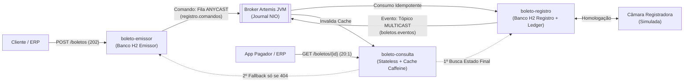

# Apresentação da Banca (Nível III) — Blocos 1 e 2 (Mateus Tavares)

> [!TIP]
> **Dois jeitos de usar este material:**
> 1. **Apresentação Visual Pronta (HTML em Tela Cheia ou para tirar Print 16:9):** Abra o arquivo **[slides-bloco1-e-2-mateus.html](file:///C:/Users/mateus/Documents/curso-ada-java/1751-be-jv-010/projetos/projeto-final-grupo/target/apresentacao-gravada/slides-bloco1-e-2-mateus.html)** no navegador e aperte **`F`** (Tela Cheia). Você pode passar os 5 slides nas setas `←` / `→` ou tirar print deles para colar direto nos slides do grupo!
> 2. **Copiar e Colar no Slide do Grupo + Roteiro da Sua Fala:** Abaixo está o conteúdo enxuto de cada um dos **5 slides** da sua parte (**Bloco 1: Problema e Domínio** + **Bloco 2: Mapa de Contextos, Corte e Arquitetura Assíncrona**) seguido exatamente do **que você deve falar** em cada slide (~3m30s no total).

---

## Slide 1 — O Problema Real de Negócio Bancário (Bloco 1)

### O que colocar no Slide:
- **Título:** Central de Cobrança e Boletos Bancários
- **Subtítulo:** Da Dor Operacional de Fim de Mês à Arquitetura Distribuída
- **Coluna 1 — O que o sistema faz:**
  - Recebe emissões de boletos de empresas conveniadas (ERPs).
  - Homologa o registro obrigatório na **Câmara Registradora externa (CIP/B3)**.
  - Disponibiliza a consulta de status e 2ª via para pagadores e empresas.
  - *(Não movimenta dinheiro: a liquidação financeira ocorre no core bancário).*
- **Coluna 2 — Por que o modelo síncrono tradicional quebra?**
  - **Pico de fechamento de mês (dias 25 a 30):** entrada de **~500 emissões/segundo**.
  - **Gargalo externo:** a Câmara Registradora leva de **1 a 5 segundos** por boleto e sofre instabilidades.
  - Bloquear o cliente esperando a Câmara causaria esgotamento de *threads* e queda em cascata (*Cascading Failure*).

### 🎤 Sua Fala no Slide 1 (~45 segundos):
> *"Boa noite, pessoal. Nós construímos a **Central de Cobrança e Boletos Bancários**. Antes de falar de tecnologia, quero mostrar o problema real de negócio que estamos resolvendo.*
> *O nosso sistema não processa o pagamento do dinheiro em si — isso é papel da compensação bancária. O nosso papel é receber a solicitação de emissão do lojista, registrar esse boleto obrigatoriamente na Câmara Registradora externa (como a CIP/B3) e disponibilizar a consulta e a 2ª via para o cliente.*
> *Qual é a grande dor aqui? Nos dias 25 a 30 de cada mês, os ERPs das empresas despejam lotes massivos de faturamento, gerando picos de **500 emissões por segundo**. Só que a Câmara Registradora externa é lenta — leva de **1 a 5 segundos** por título. Se fizéssemos isso de forma síncrona, em poucos segundos todas as threads do banco ficariam presas esperando a Câmara e o sistema inteiro cairia."*

---

## Slide 2 — As 4 Pressões do Domínio que Guiaram as Decisões (Bloco 1)

### O que colocar no Slide:
- **Título:** As 4 Pressões Reais que Moldaram a Arquitetura
- **4 Cards Visuais:**
  1. **⚡ Pressão 1 — Pico de Escrita (500 req/s) × Câmara Lenta (1–5 s):** Exige aceite assíncrono imediato (`202 Accepted`) e nivelamento de carga por fila durável.
  2. **🛡️ Pressão 2 — Risco Jurídico e Financeiro de Duplicidade:** Timeouts de rede acontecem; reenviar o mesmo pedido jamais pode gerar 2 boletos para o pagador nem cobrar 2 tarifas do banco.
  3. **⚖️ Pressão 3 — Trava Regulatória (Bacen / Febraban):** Nenhum boleto pode exibir código de barras ou linha digitável antes da confirmação oficial da Registradora (`AGUARDANDO_REGISTRO` → `REGISTRADO` | `REJEITADO`).
  4. **📈 Pressão 4 — Assimetria de Leitura (Proporção 20:1):** Para cada 1 boleto emitido, ocorrem ~20 consultas (acompanhamento de status e 2ª via).

### 🎤 Sua Fala no Slide 2 (~45 segundos):
> *"A partir desse cenário, toda a nossa arquitetura foi desenhada para responder a **quatro pressões reais do domínio bancário**:*
> *Primeiro: absorver o pico de 500 requisições por segundo respondendo rápido (`202 Accepted`) sem depender da velocidade da Câmara.*
> *Segundo: **tolerância zero a boleto duplicado** — se a internet do lojista piscar e ele mandar o mesmo POST duas vezes, não podemos gerar duas cobranças nem pagar duas tarifas de registro.*
> *Terceiro: **norma do Banco Central** — o cliente jamais pode ver linha digitável pagável enquanto o título ainda está `AGUARDANDO_REGISTRO`.*
> *E quarto: **assimetria de 20 para 1** — como as pessoas consultam 20 vezes mais do que emitem, a leitura não pode sufocar os bancos de dados de escrita."*

---

## Slide 3 — Mapa de Bounded Contexts e Isolamento (Bloco 2)

### O que colocar no Slide:
- **Título:** Mapa de Bounded Contexts e Segregação de Dados ([ADR-002](file:///C:/Users/mateus/Documents/curso-ada-java/1751-be-jv-010/projetos/projeto-final-grupo/docs/adr/ADR-002-bases-segregadas.md) e [ADR-003](file:///C:/Users/mateus/Documents/curso-ada-java/1751-be-jv-010/projetos/projeto-final-grupo/docs/adr/ADR-003-corte-tres-servicos.md))
- **3 Colunas (Os 3 Microsserviços):**
  - **1. `boleto-emissor` (Porta 8081 — Contexto de Aceite):**
    - Valida contrato, aplica idempotência de entrada (`convenio + controle` + SHA-256) e grava na *Transactional Outbox*.
    - 🗄️ **Banco exclusivo:** `H2 Emissor` (`emissao_aceita` + `outbox`).
  - **2. `boleto-registro` (Porta 8082 — Contexto de Homologação):**
    - Consome comandos da fila `ANYCAST`, integra com a Câmara (com *Ledger* `REQUIRES_NEW`), gerencia retries/DLQ e emite eventos finais.
    - 🗄️ **Banco exclusivo:** `H2 Registro` (`registro_boleto` + `ledger`).
  - **3. `boleto-consulta` (Porta 8083 — Contexto de Leitura 20:1):**
    - *Stateless*, *Cache-Aside* (Caffeine) com TTL variável (`30 s` / `10 min`), *Fallback* ao emissor só em `404` e invalidação por evento.
    - ⚡ **Sem banco próprio:** não acessa tabelas de ninguém.

### 🎤 Sua Fala no Slide 3 (~1 minuto):
> *"Para resolver essas quatro pressões, aplicamos Domain-Driven Design e cortamos o sistema em **três Bounded Contexts independentes**, seguindo o padrão **Database-per-Service (ADR-002 e ADR-003)**:*
> *1) O **`boleto-emissor`** cuida exclusivamente da ingestão rápida: valida os dados, garante a idempotência de entrada, salva o aceite e a intenção de envio no seu **próprio banco H2** usando Transactional Outbox e já devolve `202 Accepted`.*
> *2) O **`boleto-registro`** é o nosso trabalhador de integração: ele lê a fila do Artemis no ritmo que a Câmara externa aguenta, usa um **Ledger em transação independente (`REQUIRES_NEW`)** para nunca registrar nem tarifar duas vezes no mundo externo, e salva o resultado final no seu **próprio banco H2**.*
> *3) E o **`boleto-consulta`** é totalmente **stateless** — não tem banco de dados e jamais faz `SELECT` nas tabelas do emissor ou do registro. Ele protege o sistema mantendo um cache Caffeine em memória com TTL diferenciado e ouvindo eventos para limpar o cache em tempo real."*

---

## Slide 4 — Defesa do Corte: Por que 3 Microsserviços e NÃO um Monólito Modular? (Bloco 2)

### O que colocar no Slide:
- **Título:** Defesa do Corte: Microsserviços vs. Monólito Modular ([ADR-003](file:///C:/Users/mateus/Documents/curso-ada-java/1751-be-jv-010/projetos/projeto-final-grupo/docs/adr/ADR-003-corte-tres-servicos.md))
- **Tabela Comparativa:**

| Critério | Monólito Modular (Alternativa Rejeitada) | Nossa Escolha: 3 Microsserviços Segregados |
|---|---|---|
| **Isolamento de Falha Externa** | Câmara lenta (5 s) esgota o pool de threads/conexões único e **derruba a emissão e a consulta**. | Lentidão da Câmara fica contida no worker do `boleto-registro`; **Emissão (`202`) e Cache seguem 100% rápidos**. |
| **Escala Assíncrona (20:1)** | Obrigaria a escalar o monólito inteiro e multiplicar conexões de banco. | Escalamos apenas o `boleto-consulta` (*stateless*), sem tocar no registro. |
| **Contenção de Dados** | Escritas pesadas de fim de mês disputam I/O e *locks* com leituras de 2ª via no mesmo banco. | Bancos H2 fisicamente separados por contexto ([ADR-002](file:///C:/Users/mateus/Documents/curso-ada-java/1751-be-jv-010/projetos/projeto-final-grupo/docs/adr/ADR-002-bases-segregadas.md)). |

- **Trade-off Declarado (Escolha + Sacrifício + Contexto):**
  - **O que ganhamos:** Isolamento de falhas (*Bulkhead*) e escala independente por perfil não-funcional.
  - **O que abrimos mão:** Transação ACID global simples e deploy único — assumimos **consistência eventual** entre aceite e registro.
  - **Quando NÃO usaríamos microsserviços:** Se a volumetria fosse baixa e o registro fosse interno/rápido (~10 ms), um **Monólito Modular** seria superior.

### 🎤 Sua Fala no Slide 4 (~45 segundos):
> *"E por que cortamos em três microsserviços em vez de fazer um Monólito Modular? Nós sabemos que microsserviços trazem custo de rede e consistência eventual — se o nosso volume fosse baixo e não dependêssemos de uma câmara externa lenta, um **Monólito Modular** seria a escolha certa.*
> *Mas no nosso contexto, Emissão, Registro e Consulta têm **requisitos não-funcionais opostos**: num monólito com banco único, quando a Câmara demorasse 5 segundos no pico do dia 30, ela prenderia as conexões do pool e derrubaria a emissão e a consulta juntas.*
> *Por isso escolhemos 3 serviços com bancos segregados, **abrindo mão da consistência imediata global** em troca de garantir que o emissor nunca pare de aceitar boletos e a consulta nunca pare de responder."*

---

## Slide 5 — Fronteiras de Consistência, Outbox e Fila × Tópico (Bloco 2)

### O que colocar no Slide:
- **Título:** Consistência Forte × Eventual e Fila (`ANYCAST`) × Tópico (`MULTICAST`)
- **Bloco A — Onde a Consistência é FORTE (ACID Local via *Transactional Outbox* — [ADR-005](file:///C:/Users/mateus/Documents/curso-ada-java/1751-be-jv-010/projetos/projeto-final-grupo/docs/adr/ADR-005-saga-e-outbox-no-mvp.md)):**
  - **No Emissor:** grava `emissao_aceita` + `comando_registro_outbox` na **mesma transação H2** antes de enviar ao broker (elimina o *Dual-Write Problem*).
  - **No Registro:** grava `registro_boleto` + histórico + `evento_outbox` na **mesma transação H2** (com o *Ledger* da Câmara em `REQUIRES_NEW` — [ADR-010](file:///C:/Users/mateus/Documents/curso-ada-java/1751-be-jv-010/projetos/projeto-final-grupo/docs/adr/ADR-010-contrato-funcional-e-idempotencia-registradora.md)).
- **Bloco B — Onde a Consistência é EVENTUAL (Broker Artemis JVM — [ADR-007](file:///C:/Users/mateus/Documents/curso-ada-java/1751-be-jv-010/projetos/projeto-final-grupo/docs/adr/ADR-007-transporte-assincrono.md), [ADR-011](file:///C:/Users/mateus/Documents/curso-ada-java/1751-be-jv-010/projetos/projeto-final-grupo/docs/adr/ADR-011-broker-jvm-artemis.md), [ADR-012](file:///C:/Users/mateus/Documents/curso-ada-java/1751-be-jv-010/projetos/projeto-final-grupo/docs/adr/ADR-012-eventos-e-invalidacao.md)):**
  - **Emissor → Registro é FILA (`ANYCAST` — `registro.comandos`):** carrega um **Comando** (*ordem imperativa*) que deve ser processado por **apenas 1 trabalhador**. Falha transitória sofre 3 tentativas (`1 s` e `5 s`) antes de ir para a **DLQ (`registro.quarentena`)**; JSON inválido (*poison pill*) vai para a DLQ na hora.
  - **Registro → Consulta é TÓPICO (`MULTICAST` — `boletos.eventos`):** carrega um **Evento de Domínio** (*fato consumado no passado*: `BoletoRegistrado` / `RegistroRejeitado`), permitindo que múltiplos consumidores assinem de forma independente.

### 🎤 Sua Fala no Slide 5 (~30 segundos — Gancho perfeito para passar a bola para a Demo!):
> *"Por fim, como garantimos que nenhum boleto se perca entre esses três serviços? Dentro de cada serviço a consistência é **forte (ACID)** usando **Transactional Outbox**: o emissor salva o boleto e a mensagem na tabela Outbox do próprio banco H2 na mesma transação, eliminando o risco de escrita dupla.*
> *Entre os serviços, a comunicação passa pelo Apache ActiveMQ Artemis com entrega **at-least-once**: de Emissor para Registro usamos **Fila `ANYCAST`**, porque é um **Comando** que só um trabalhador deve executar (com 3 retries de 1s e 5s e quarentena DLQ); e do Registro para a Consulta usamos **Tópico `MULTICAST`**, porque é um **Evento no passado** que invalida o cache imediatamente. Vou passar agora para os meus colegas demonstrarem esse fluxo rodando ao vivo nas 4 JVMs!"*
