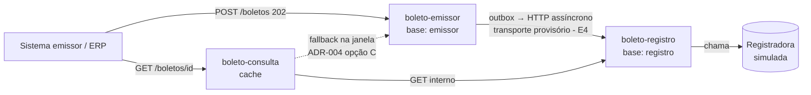

# Arquitetura — Central de Cobrança e Boletos

> **Estado: E4.** Emissão idempotente, outbox transacional, entrega assíncrona HTTP e consulta com cache-aside; detalhes em [`etapas/`](etapas/).

## Serviços (bounded contexts)

| Serviço | Porta | Base | Responsabilidade |
|---|:-:|---|---|
| `boleto-emissor` | 8081 | H2 `emissor` (própria) | Receber POST, validar, persistir aceite (202), idempotência |
| `boleto-registro` | 8082 | H2 `registro` (própria) | Consumir comando assíncrono, simular registradora, manter estado |
| `boleto-consulta` | 8083 | sem base (ADR-004, opção C) | Consulta por identificador, fallback e cache |
| `shared-contracts` | — | — | Records de comandos/eventos/DTOs |

## Diagrama de contextos

## Fluxo implementado
1. Sistema cliente solicita emissão → 2. valida campos e idempotência → 3. persiste aceite e outbox na mesma transação, responde 202.
4. O despachante entrega o comando ao registro por HTTP em segundo plano → consumidor idempotente simula a registradora e persiste o estado final.
5. A consulta lê cache; no miss tenta registro e, se ainda não existe, busca o aceite no emissor.

HTTP é provisório, não um message broker. A E5 poderá adicionar RabbitMQ quando houver Docker, sem alterar o contrato do comando nem a regra de processamento.

## Máquina de estados
`AGUARDANDO_REGISTRO → REGISTRADO | REJEITADO` (detalhe em `requisitos/glossario-e-regras.md`).

## Decisões
- [ADR-001](adr/ADR-001-stack-java17-e-perfis.md) stack e perfis · [ADR-002](adr/ADR-002-bases-segregadas.md) bases segregadas · [ADR-003](adr/ADR-003-corte-tres-servicos.md) corte em 3 serviços · [ADR-004](adr/ADR-004-fonte-do-estado-inicial.md) estado inicial (**opção C aceita pelo grupo**) · [ADR-005](adr/ADR-005-saga-e-outbox-no-mvp.md) SAGA/outbox (**outbox aceita na E4**) · [ADR-006](adr/ADR-006-cache-consulta.md) cache da consulta (**provisória**) · [ADR-007](adr/ADR-007-transporte-assincrono.md) transporte HTTP provisório

## Garantia de entrega e idempotência
O emissor persiste o aceite e o comando outbox na mesma transação antes de responder. O transporte HTTP tenta entregar pelo menos uma vez; em caso de resposta perdida pode haver reentrega, que o registro trata de forma idempotente usando o UUID.

## Consulta e cache
`boleto-consulta` usa Caffeine cache-aside por UUID: TTL provisório de 30 s para `AGUARDANDO_REGISTRO` e 10 min para estados finais. No miss, consulta registro e usa fallback no emissor somente quando recebe 404. Não cacheia 404; falhas técnicas retornam 503 com correlation ID. Ver [ADR-006](adr/ADR-006-cache-consulta.md).
