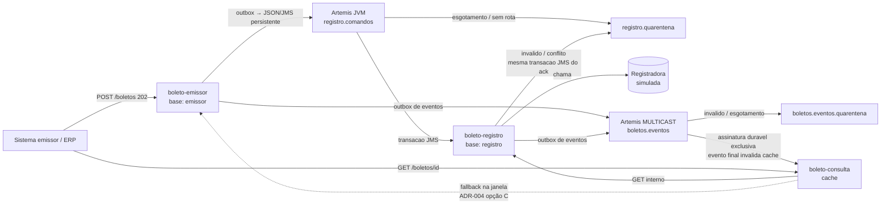

# Arquitetura — Central de Cobrança e Boletos

> **Estado: E10, comandos/eventos por Artemis, limites HTTP e correlação.** Domínio/ledger E7, PACT, outbox de eventos e cache coordenado preservados; sem Docker. Evidências: [E8](etapas/E8-broker-jvm.md), [E9](etapas/E9-eventos-e-cache.md) e [E10](etapas/E10-resiliencia-e-correlacao.md).

## Serviços (bounded contexts)

| Serviço | Porta | Base | Responsabilidade |
|---|:-:|---|---|
| `boleto-emissor` | 8081 | H2 `emissor` (própria) | Receber POST, validar, persistir aceite (202), idempotência |
| `boleto-registro` | 8082 | H2 `registro` (própria) | Consumir comando assíncrono, simular registradora, manter estado |
| `boleto-consulta` | 8083 | sem base (ADR-004, opção C) | Consulta por identificador, fallback e cache |
| `shared-contracts` | — | — | Records/DTOs, eventos mínimos, pact canônico e validação estrutural; sem Spring/JPA |
| `eventos-outbox` | — | tabelas nos H2 dos produtores | Infraestrutura técnica reutilizada, não é serviço nem banco compartilhado |
| `infraestrutura-http` | — | — | Filtro/contexto de correlação comum aos três serviços, sem JPA/negócio |
| `cobranca-broker` | 61616 | Journal NIO próprio | Comandos/quarentenas e pub/sub durável de eventos; somente loopback |

## Diagrama de contextos

## Fluxo implementado
1. Sistema cliente solicita emissão → 2. valida campos e idempotência → 3. persiste aceite + comando + intenção de evento na mesma transação, responde 202.
4. O despachante de comandos publica no broker em segundo plano e conclui a outbox somente após commit JMS. Consumidor idempotente simula a registradora, confirma resultado + histórico + intenção final JPA e só depois confirma JMS.
5. Despachantes de eventos publicam após commit local, sem bloquear negócio por disponibilidade de assinante.
6. A consulta lê cache; no miss tenta registro e, se ainda não existe, busca o aceite no emissor. Evento final invalida a entrada e confirma JMS somente após coordenar eventual preenchimento em voo.

Artemis 2.33.0/Jakarta JMS foi validado com Java 17/Windows e Boot 3.3.5. Broker em processo separado, armazenamento NIO, comandos ANYCAST e eventos MULTICAST com assinaturas duráveis, sem criação automática de destinos. E9 testa envelope real em dois assinantes, um offline, preservando pendência após reinício. Não há fallback HTTP.

## Contrato executável de leitura

A E6 verifica GET interno consulta ↔ registro para registrado/rejeitado/inexistente, com o cliente REST real no consumidor e aplicação HTTP/H2 real no provedor. Um [pact canônico](../shared-contracts/pacts/boleto-consulta-boleto-registro.json) é comparado ao gerado em cada `verify`, sem depender da ordem dos módulos. Na E7, os dois lados/artefato foram atualizados para dados de pagamento não pagáveis. Ver [ADR-009](adr/ADR-009-contrato-consulta-registro.md) e [evidências E7](etapas/E7-contrato-funcional.md).

## Registro funcional e simulação externa

A E7 reutiliza a validação estrutural da solicitação nas duas fronteiras. Novas aprovações persistem `NAO-PAGAVEL-SIM-LINHA-{uuid}` / `NAO-PAGAVEL-SIM-BARRAS-{uuid}`, identificador simulado e instante; rejeições não expõem dados de pagamento. A projeção pública preserva essa separação.

O aceite original fica no emissor. O registro guarda origem/estado final em `registro_historico` na mesma transação do resultado local. A simulada mantém comando/resposta por UUID em `registradora_simulada_operacao`, com transação independente `REQUIRES_NEW` no H2 do registro: representa o commit externo e sobrevive a perda de resposta/rollback local. Não é atomicidade distribuída nem banco compartilhado entre serviços.

Estados finais locais não chamam a registradora novamente. Registros antigos permanecem como foram gravados, sem preencher fatos retroativos inventados. Essa simulação não garante idempotência de uma registradora real; controles de acesso/auditoria completa continuam E11. Ver [ADR-010](adr/ADR-010-contrato-funcional-e-idempotencia-registradora.md).

## Máquina de estados
`AGUARDANDO_REGISTRO → REGISTRADO | REJEITADO` (detalhe em `requisitos/glossario-e-regras.md`).

## Decisões
- [ADR-001](adr/ADR-001-stack-java17-e-perfis.md) stack e perfis · [ADR-002](adr/ADR-002-bases-segregadas.md) bases segregadas · [ADR-003](adr/ADR-003-corte-tres-servicos.md) corte em 3 serviços · [ADR-004](adr/ADR-004-fonte-do-estado-inicial.md) estado inicial (**opção C aceita pelo grupo**) · [ADR-005](adr/ADR-005-saga-e-outbox-no-mvp.md) SAGA/outbox · [ADR-006](adr/ADR-006-cache-consulta.md) TTL provisório · [ADR-007](adr/ADR-007-transporte-assincrono.md)/[ADR-008](adr/ADR-008-retry-e-isolamento-outbox.md) histórico HTTP · [ADR-011](adr/ADR-011-broker-jvm-artemis.md) transporte vigente · [ADR-012](adr/ADR-012-eventos-e-invalidacao.md) eventos e invalidação

## Garantia de entrega e idempotência
O emissor persiste o aceite e o comando outbox na mesma transação antes de responder. Publicação JMS persistente e transacional confirma armazenamento no broker, não resultado de negócio. Confirmação perdida pode duplicar publicação; falha após commit JPA e antes do ack JMS pode duplicar consumo. O registro usa UUID/conteúdo/ledger E7 para recuperar o mesmo resultado. Não há XA nem exactly-once.

O produtor mantém três tentativas de publicação, com backoff de 1 s/5 s; esgotamento fica no H2, fora dos lotes elegíveis. A API `/interno/outbox/falhas` expõe metadados de até 20 isolamentos do produtor, não mensagens do broker. Consumidor tem três entregas do broker, com 1 s/5 s, e DLQ durável no esgotamento. JSON/envelope/conflito inválido é transferido imediatamente, na mesma transação JMS que confirma o original. Rejeição de negócio persiste `REJEITADO` e confirma processamento, sem DLQ.

Fila ausente impede concluir a publicação; mensagem sem binding de comandos é encaminhada pelo broker à quarentena. Contador de entregas persistido antes de entregar. Migração não reinicia isolados/contadores nem republica entregues HTTP; o campo `entregue_em` antigo conserva seu significado histórico. [E8](etapas/E8-broker-jvm.md).

Não há promessa de registro eventual após isolamento nem replay automático. Broker local sem autenticação/TLS, somente loopback; proteção e operação restrita continuam E11/E12. Não expor arquivos/portas em rede não confiável.

## Consulta e cache
`boleto-consulta` usa Caffeine cache-aside por UUID: TTL provisório de 30 s para `AGUARDANDO_REGISTRO` e 10 min para estados finais. No miss, consulta registro e usa fallback no emissor somente quando recebe 404. Não cacheia 404; falhas técnicas retornam 503 com correlation ID. Ver [ADR-006](adr/ADR-006-cache-consulta.md).

E9 complementa TTL com invalidação após `BoletoRegistrado`/`RegistroRejeitado`. Mesmas 64 travas coordenam cache miss/preenchimento e remoção antes do ack; resposta em voo pode ser transitória, mas não reinstala cache antigo depois da confirmação. Evento mínimo não constrói resposta completa; próxima leitura busca a fonte. Duplicatas/fora de ordem só repetem remoção.

**Uma instância de cada serviço na demonstração.** Cada instância adicional de consulta com cache local exigiria assinatura durável própria, não consumidor concorrente na mesma fila. Intenções ficam nos bancos locais, são publicadas com confirmação/retry/isolamento independentes e não recebem backfill retroativo. E10 propaga correlação HTTP validada; legados sem campo usam UUID do boleto. Operação e testes na [E9](etapas/E9-eventos-e-cache.md) / [E10](etapas/E10-resiliencia-e-correlacao.md).

## Resiliência e rastreabilidade (E10)

Cada fonte HTTP da consulta possui circuito Resilience4j independente: janela de três chamadas/minimo três, 100% de falhas técnicas abre por 10 s, uma sonda meia-aberta. Sucesso/404 fecha; falha reabre. Conexão 2 s/leitura 3 s, sem redirect ou retry de aplicação. OPEN/falha técnica -> 503, não 404 nem fallback; cache hit continua disponível. Registradora permanece chamada Java local; retry de outbox/redelivery JMS não mudou.

Filtro comum valida/gera UUID v4 no `X-Correlation-ID`, responde o mesmo header inclusive nos erros e limpa contexto/MDC ao sair. Emissão persiste o id no comando/evento; JMS e registro preservam até evento final e invalidação. GETs internos usam a correlação do pedido atual, não do preenchimento anterior do cache. Registro/ledger excluem somente metadado de correlação ao comparar negócio; reenvio não repete efeito. Header JMS presente deve coincidir com envelope, sob pena de quarentena.

Circuito é local, não persistido; limites de socket não são deadline global. Logs mínimos/correlação não substituem auditoria/autorização E11. Inventário, alternativas e compatibilidade na [ADR-013](adr/ADR-013-resiliencia-e-correlacao.md); jornadas finais continuam E14.
