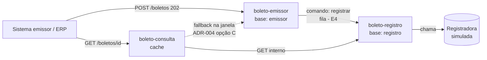

# Arquitetura — Central de Cobrança e Boletos

> **Estado: E1.** Contextos e fluxo-alvo definidos; atualizada a cada etapa. Raciocínio completo em [`etapas/E1-ddd-e-emissao.md`](etapas/E1-ddd-e-emissao.md).

## Serviços (bounded contexts)

| Serviço | Porta | Base | Responsabilidade |
|---|:-:|---|---|
| `boleto-emissor` | 8081 | H2 `emissor` (própria) | Receber POST, validar, aceitar (202), idempotência |
| `boleto-registro` | 8082 | H2 `registro` (própria) | Consumir fila, registrar título, manter estado |
| `boleto-consulta` | 8083 | sem base (ADR-004, opção C) | Consulta por identificador com cache |
| `shared-contracts` | — | — | Records de comandos/eventos/DTOs |

## Diagrama de contextos

## Fluxo-alvo (8 passos do glossário)
1. Sistema cliente solicita emissão → 2. valida campos e idempotência → 3. persiste aceite, responde 202 → 4. segue à fila de registro → 5. consumidor registra → 6. resultado atualiza estado e cache → 7. eventos por outbox → 8. consulta lê cache e, no miss, a fonte persistente.

## Máquina de estados
`AGUARDANDO_REGISTRO → REGISTRADO | REJEITADO` (detalhe em `requisitos/glossario-e-regras.md`).

## Decisões
- [ADR-001](adr/ADR-001-stack-java17-e-perfis.md) stack e perfis · [ADR-002](adr/ADR-002-bases-segregadas.md) bases segregadas · [ADR-003](adr/ADR-003-corte-tres-servicos.md) corte em 3 serviços · [ADR-004](adr/ADR-004-fonte-do-estado-inicial.md) estado inicial (**proposta**)

## Garantia de entrega e idempotência
*(a declarar na E4: at-least-once + consumidor idempotente)*
