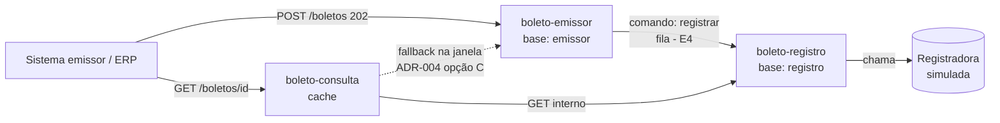

# Arquitetura — Central de Cobrança e Boletos

> **Estado: E3.** Emissão idempotente persistida e consulta com cache-aside; detalhes em [`etapas/`](etapas/).

## Serviços (bounded contexts)

| Serviço | Porta | Base | Responsabilidade |
|---|:-:|---|---|
| `boleto-emissor` | 8081 | H2 `emissor` (própria) | Receber POST, validar, persistir aceite (202), idempotência |
| `boleto-registro` | 8082 | H2 `registro` (própria) | Consumir fila, registrar título, manter estado |
| `boleto-consulta` | 8083 | sem base (ADR-004, opção C) | Consulta por identificador, fallback e cache |
| `shared-contracts` | — | — | Records de comandos/eventos/DTOs |

## Diagrama de contextos

## Fluxo implementado e fluxo-alvo
1. Sistema cliente solicita emissão → 2. valida campos e idempotência → 3. persiste aceite, responde 202.
4. **Futuro (E4):** segue à fila de registro → consumidor registra → resultado atualiza estado.
5. **Consulta implementada (E3):** lê cache; no miss tenta registro e, se ainda não existe, busca o aceite no emissor.

## Máquina de estados
`AGUARDANDO_REGISTRO → REGISTRADO | REJEITADO` (detalhe em `requisitos/glossario-e-regras.md`).

## Decisões
- [ADR-001](adr/ADR-001-stack-java17-e-perfis.md) stack e perfis · [ADR-002](adr/ADR-002-bases-segregadas.md) bases segregadas · [ADR-003](adr/ADR-003-corte-tres-servicos.md) corte em 3 serviços · [ADR-004](adr/ADR-004-fonte-do-estado-inicial.md) estado inicial (**opção C aceita pelo grupo**) · [ADR-005](adr/ADR-005-saga-e-outbox-no-mvp.md) SAGA/outbox (**proposta para o grupo**) · [ADR-006](adr/ADR-006-cache-consulta.md) cache da consulta (**provisória**)

## Garantia de entrega e idempotência
Na E2, o emissor persiste o aceite antes de responder e protege a chave `convenio + numero_controle_cliente` com restrição única. A garantia de entrega da fila e a idempotência do consumidor serão definidas na E4.

## Consulta e cache
`boleto-consulta` usa Caffeine cache-aside por UUID: TTL provisório de 30 s para `AGUARDANDO_REGISTRO` e 10 min para estados finais. No miss, consulta registro e usa fallback no emissor somente quando recebe 404. Não cacheia 404; falhas técnicas retornam 503 com correlation ID. Ver [ADR-006](adr/ADR-006-cache-consulta.md).
