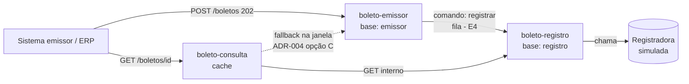

# E1 — DDD, bounded contexts e emissão validada

**Status:** primeira implementação e documentação concluídas · `mvn clean verify` passou (17 testes, sem falhas). Testes manuais HTTP continuam pendentes (ver [`../validacao-pendente.md`](../validacao-pendente.md)). O solicitante aceitou a opção C do ADR-004; falta compartilhar com o grupo.
**Referência no gabarito:** `aula-01` · plano de aula 1 §3–§7 · **ADRs:** [002](../adr/ADR-002-bases-segregadas.md), [003](../adr/ADR-003-corte-tres-servicos.md), [004](../adr/ADR-004-fonte-do-estado-inicial.md)

## Objetivo
Entender o domínio **antes** de codar: descobrir eventos, comandos e agregados, cortar em contextos, e só então implementar a primeira fatia (validação da emissão → 202/400).

---

## 1. Linguagem ubíqua (resumo; completa em `requisitos/glossario-e-regras.md`)

| Termo | Significado no nosso domínio |
|---|---|
| Emissão | Receber e validar a solicitação; criar a identidade da cobrança |
| Aceite | Resposta 202: *aceita para processamento* (≠ registrado) |
| Registro | Confirmação do título pela registradora |
| Título/Boleto | Representação da cobrança |
| Estado | `AGUARDANDO_REGISTRO` → `REGISTRADO` \| `REJEITADO` |

> Regra de ouro (Sandra, sessão 2): a resposta nunca pode dizer "boleto registrado" no POST.

## 2. Event storming

**Passo 1 — Eventos (fatos no passado):**
`EmissaoSolicitada` · `EmissaoRejeitadaPorValidacao` · **`EmissaoAceita`** · `EmissaoReenviadaIdempotente` · `RegistroSolicitado` · **`BoletoRegistrado`** · **`RegistroRejeitado`** · `RegistroFalhouTemporariamente` · `MensagemEnviadaParaDLQ` · `BoletoConsultado`

**Passo 2 — Comandos e atores:**

| Comando | Ator | Gera |
|---|---|---|
| EmitirBoleto | Sistema emissor (ERP) | EmissaoAceita / EmissaoRejeitadaPorValidacao |
| RegistrarBoleto | Consumidor da fila (sistema) | BoletoRegistrado / RegistroRejeitado |
| ConsultarBoleto | Sistema emissor, atendente | BoletoConsultado |
| ReprocessarDLQ | Operação | RegistroSolicitado |

**Passo 3 — Entidades, VOs e agregado:**
- **Agregado `Boleto`** (raiz = entidade, id = UUID interno). Invariante: *só `REGISTRADO` tem linha digitável/código de barras; estados finais não mudam*.
- **Value Objects** (imutáveis, sem identidade, comparados por valor): `Pessoa`, `Endereco`, `Valor`, `Encargo` (juros/multa), `Desconto`, `ChaveIdempotencia(convenio, numeroControle)`.
- Neste código, os VOs já existem como `record` em `shared-contracts` (`Pessoa`, `Endereco`, `Encargo`, `Desconto`).

**Passo 4 — Políticas ("sempre que X, então Y"):**
- Sempre que `EmissaoAceita` → solicitar registro (fila).
- Sempre que `BoletoRegistrado`/`RegistroRejeitado` → atualizar estado e invalidar cache.
- Sempre que falha temporária → retentar; esgotadas → DLQ.
- Sempre que o mesmo convênio+controle chegar → devolver o resultado original (igual) ou 409 (diferente).

**Passo 5 — Hotspots (dúvidas):**
1. **Quem guarda o estado inicial para a consulta?** → [ADR-004](../adr/ADR-004-fonte-do-estado-inicial.md) *(proposta, o grupo decide)*.
2. Como invalidar o cache quando outro serviço muda o estado? → E3.
3. Outbox/eventos entram no MVP? → opcional.
4. Contrato real da registradora (códigos, timeouts) → premissas.

## 3. Bounded contexts → microsserviços



**Context map:** `emissor → registro` = **Customer/Supplier** via mensagem (contrato em `shared-contracts`); `consulta → registro/emissor` = **Conformist** (consome o modelo deles). A registradora é externa → futura **camada anticorrupção** (E4/E5).

> Bounded context ≠ microsserviço obrigatoriamente; aqui coincidem porque cada contexto tem linguagem, dados e razão de escala próprias (ADR-003).

## 4. O que foi implementado

| Arquivo | Papel |
|---|---|
| `shared-contracts/*` | records `EmitirBoletoRequest`, `Pessoa`, `Endereco`, `Encargo`, `Desconto`, `BoletoAceito`, `ErroValidacao`, `CampoInvalido`, enums `StatusBoleto`, `TipoDocumento`, `TipoEncargo` |
| `EmissaoValidator` | Regras da sessão 2; **acumula todos os erros** (não para no primeiro) |
| `EmissaoService` | Valida → devolve `BoletoAceito` (id UUID v4 + `AGUARDANDO_REGISTRO`) |
| `BoletoController` | `POST /boletos` → **202** |
| `ErroHandler` | Erros → **400** com `{ "erros": [{campo, motivo}] }` |
| Testes | `EmissaoValidatorTest` (puro) e `BoletoControllerTest` (MockMvc) |

**Ainda NÃO faz (de propósito):** persistir o aceite, idempotência/409 (→ E2) e publicar na fila (→ E4). O 202 desta etapa é um *stub honesto*.

## 5. Decisões de desenho (para defender)
- **400 com lista completa:** pedido da sessão 2 (quem integra corrige tudo de uma vez). Diferente do PIX, que lançava exceção no 1º erro.
- **Sem eco do valor** no erro: o valor pode ser dado pessoal (LGPD, sessão 5).
- **`especie`/tamanhos** são premissas; documento só tem validação de **tamanho e dígitos** (o cálculo dos dígitos verificadores do CPF/CNPJ ficou fora).
- **Records no `shared-contracts`:** o `EmitirBoletoRequest` será reaproveitado no comando de registro (E4).

## 6. Exemplo (curl) — para quando rodar
```bash
curl -i -X POST http://localhost:8081/boletos -H "Content-Type: application/json" -d '{
 "convenio":"123456","numero_controle_cliente":"NF-0001",
 "beneficiario":{"nome":"Empresa X","tipo_documento":"CNPJ","numero_documento":"12345678000195",
   "endereco":{"logradouro":"Rua A, 1","cidade":"Brasilia","uf":"DF","cep":"70000000"}},
 "pagador":{"nome":"Maria","tipo_documento":"CPF","numero_documento":"12345678909",
   "endereco":{"logradouro":"Rua B, 2","cidade":"Brasilia","uf":"DF","cep":"70000000"}},
 "valor_nominal":150.00,"data_emissao":"2026-10-19","data_vencimento":"2026-11-19","especie":"DM"}'
```
Esperado: `202` com `identificador`, `status: AGUARDANDO_REGISTRO`, `data_hora_recebimento`. Mude `convenio` para `"1"` → `400` com a lista de erros.

## 7. Evidência para a rubrica
Critério 1 (decomposição: ADR-002/003, arquitetura) e 7 (ADRs com alternativas). Hotspots documentados.

## Para vocês discutirem em grupo
O event storming e as decisões abaixo são um rascunho documentado para orientar o grupo, não substituem a discussão conjunta.

1. A opção C do ADR-004 foi aceita pelo solicitante. O grupo identifica algum risco ou motivo para rever a decisão?
2. `Boleto` e `Pessoa`: por que um é entidade e o outro VO? E se `Pessoa` precisasse de histórico?
3. Por que a validação síncrona não consulta a registradora?
