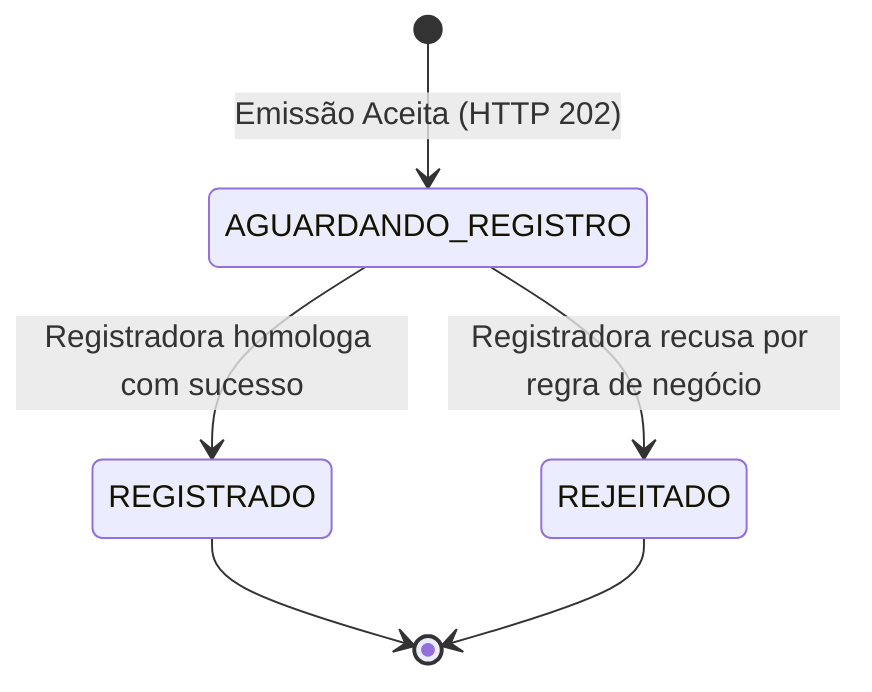
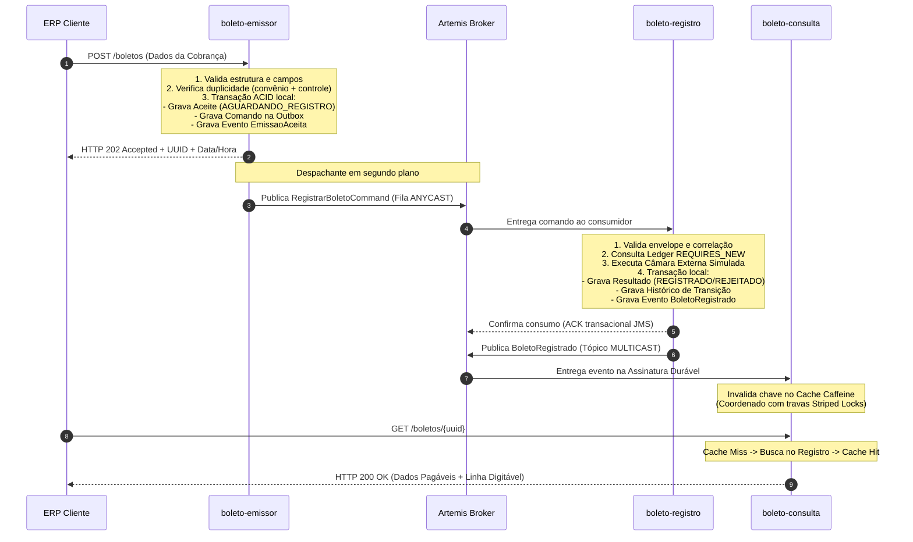

# Guia didático do projeto — Central de Cobrança e Boletos

**Para quem é:** integrantes da equipe e revisores que precisam dominar os fundamentos de negócio, as decisões de arquitetura e o funcionamento técnico da solução.
**Versão de referência:** arquitetura E0–E10 consolidada, com catálogo de pacotes organizado por responsabilidade e laboratório local de demonstração.
**Objetivo:** explicar o problema bancário real que resolvemos, como as peças arquiteturais se conectam e como defender as escolhas sob arguição técnica de nível especialista.

O sistema possui uma suíte automatizada de **277 testes aprovados** (incluindo testes de integração, testes de concorrência com latches e testes de contrato executável PACT), comprovando os padrões implementados sem necessidade de contêineres Docker externos.

Para experimentar visualmente o fluxo em tempo de execução, utilize o [laboratório web de demonstração](painel-demonstracao.md).

---

## Índice

1. [O Problema Real de Negócio e o Vocabulário](#1-o-problema-real-de-negócio-e-o-vocabulário)
2. [As Peças e as Tecnologias Escolhidas](#2-as-peças-e-as-tecnologias-escolhidas)
3. [O Ciclo de Vida de uma Cobrança Ponta a Ponta](#3-o-ciclo-de-vida-de-uma-cobrança-ponta-a-ponta)
4. [A Engenharia por Trás das Escolhas (Trade-offs Reais)](#4-a-engenharia-por-trás-das-escolhas-trade-offs-reais)
5. [Como Navegar nas Pastas e no Código Java/Spring](#5-como-navegar-nas-pastas-e-no-código-javaspring)
6. [Catálogo das Classes de Produção](#6-catálogo-das-classes-de-produção)
7. [APIs, Dados e Configurações](#7-apis-dados-e-configurações)
8. [Roteiro Prático de Estudo e Experimentação](#8-roteiro-prático-de-estudo-e-experimentação)
9. [Verificação dos Padrões Arquiteturais e Testabilidade](#9-verificação-dos-padrões-arquiteturais-e-testabilidade)
10. [A Evolução Arquitetural do Sistema](#10-a-evolução-arquitetural-do-sistema)
11. [Fronteiras do MVP (Fase 1) vs Evoluções Futuras (Fase 2)](#11-fronteiras-do-mvp-fase-1-vs-evoluções-futuras-fase-2)
12. [Banco de Perguntas e Respostas para a Banca de Defesa](#12-banco-de-perguntas-e-respostas-para-a-banca-de-defesa)

---

## 1. O Problema Real de Negócio e o Vocabulário

A Caixa / Instituição Financeira atende a milhares de clientes corporativos (ERPs de indústrias, plataformas de e-commerce, concessionárias de serviços públicos, condomínios e escolas). Esses clientes faturam e emitem milhões de boletos de cobrança todos os meses.

A Central de Cobrança e Boletos **não realiza a movimentação financeira nem a liquidação do dinheiro** (que ocorre na compensação bancária e na CIP/PIX dias depois, no momento em que o pagador quita o título). Sua missão crítica é **receber as solicitações de cobrança, garantir o registro regulatório obrigatório perante a Câmara Centralizada e disponibilizar o título para consulta massiva**.

### As Quatro Dores Reais do Domínio Bancário:

1. **O Pico da Virada de Mês e o Efeito Cascata:**
   Nos fechamentos contábeis (virada de mês, dias 5, 10 e 20), os ERPs disparam lotes massivos de cobrança (até 500 requisições/s). As Registradoras Centrais (CIP/B3) são sistemas externos que sofrem lentidão, instabilidade e janelas de manutenção. Se a emissão do banco chamasse a registradora de forma síncrona, as threads do banco travariam, os ERPs tomariam *timeout* e o faturamento das empresas pararia.
   * *Solução:* **Aceite assíncrono desacoplado (`202 Accepted`) com Transactional Outbox e fila de amortecimento**.
2. **O Pesadelo da Cobrança Duplicada (Risco Jurídico e Financeiro):**
   Diante de oscilações de rede, os ERPs reenviam lotes de cobrança "por garantia". Sem um rigoroso controle de idempotência, o banco registraria duas vezes a mesma nota fiscal, gerando dois boletos para o mesmo pagador. Isso gera protestos indevidos em cartório, cobrança duplicada, multas do Procon/Bacen e pesados processos de indenização contra o banco.
   * *Solução:* **Idempotência estrita em dois níveis**: na entrada da emissão (`convenio + numero_controle_cliente`, gerando `409 Conflict` se o payload divergir) e no consumidor do registro (com **Ledger transacional independente `REQUIRES_NEW`**).
3. **O Pagador que tenta Pagar e toma "Boleto Não Registrado":**
   Pela regulamentação do Banco Central e normas da Febraban, **nenhum boleto pode ser liquidado sem prévio registro na base centralizada**. Se o sistema entrega a linha digitável ou o código de barras antes da confirmação da registradora, o sacado abre o aplicativo do seu banco, digita o código e recebe: *"Título não encontrado / Boleto não registrado"*. O cliente desconfia de fraude e sobrecarrega o suporte do banco.
   * *Solução:* **Máquina de estados estrita** (`AGUARDANDO_REGISTRO` → `REGISTRADO` | `REJEITADO`). Linha digitável e código de barras só são gerados e expostos após a confirmação efetiva do registro.
4. **Assimetria Massiva de Tráfego (Leitura 20 : 1 Escrita):**
   Para cada boleto emitido, há dezenas de consultas (ERPs conferindo status de remessa, pagadores imprimindo 2ª via, portais corporativos). Se todo esse tráfego batesse direto no mesmo banco relacional do registro, causaria disputa de *locks*, esgotamento de conexões e colapso da gravação.
   * *Solução:* **Microsserviço de Consulta segregado**, sem banco relacional próprio, usando **cache-aside Caffeine com TTL diferenciado** e **invalidação reativa orientada a eventos**.



### Glossário Ubíquo do Projeto

| Termo | Significado no Domínio de Cobrança |
|---|---|
| **Beneficiário (Cedente)** | Empresa cliente que emite a cobrança e receberá os fundos após a liquidação. |
| **Pagador (Sacado)** | Pessoa física ou jurídica indicada para pagar o título. |
| **Convênio** | Código numérico de 6 dígitos que identifica o contrato da empresa com o banco. |
| **Número de Controle do Cliente** | Identificador único do título no sistema do cliente (ex.: número da Nota Fiscal ou Fatura). |
| **UUID do Boleto** | Identificador canônico global gerado pela Central de Cobrança para rastreabilidade única. |
| **Câmara Registradora (CIP/B3)** | Entidade externa regulatória central onde todo boleto bancário nacional deve ser registrado. |
| **Aceite de Emissão (`202 Accepted`)** | Reconhecimento formal de que a cobrança foi validada e acolhida com garantia de processamento. |
| **Idempotência Radical** | Garantia matemática de que reenviar a mesma cobrança N vezes produzirá o mesmo efeito de negócio. |
| **Consistência Eventual** | O aceite da cobrança e a confirmação do registro ocorrem em momentos diferentes no tempo. |
| **Bounded Context** | Fronteira delimitada de domínio com modelo de dados, linguagem e ciclo de vida autônomos. |

---

## 2. As Peças e as Tecnologias Escolhidas

O sistema é composto por **três microsserviços de negócio e um broker de mensageria em processo dedicado**, complementados por módulos compartilhados de contratos e infraestrutura.

| Módulo | Papel Arquitetural | Execução e Armazenamento |
|---|---|---|
| [**`boleto-emissor`**](../boleto-emissor/) | Ingestão de alta vazão, validação cadastral, idempotência de entrada e outbox | JVM própria; HTTP 8081; Base H2 `emissor` própria |
| [**`boleto-registro`**](../boleto-registro/) | Consumo assíncrono, orquestração com câmara externa, ledger e histórico | JVM própria; HTTP 8082; Base H2 `registro` própria |
| [**`boleto-consulta`**](../boleto-consulta/) | Borda de leitura ultrarrápida, cache em memória, fallback e circuit breakers | JVM própria; HTTP 8083; Sem banco relacional (Cache-aside) |
| [**`cobranca-broker`**](../cobranca-broker/) | Broker corporativo Apache ActiveMQ Artemis (filas ANYCAST e tópicos MULTICAST) | JVM própria; TCP 61616/61617; Armazenamento em Journal NIO |
| [**`shared-contracts`**](../shared-contracts/) | Biblioteca pura com contratos canônicos, DTOs, eventos e especificações PACT | Biblioteca sem runtime ou banco; compartilhada em compilação |
| [**`eventos-outbox`**](../eventos-outbox/) | Infraestrutura reutilizável para gravação e despacho atômico de eventos de domínio | Componente executado nos produtores (tabelas nos bancos locais) |
| [**`infraestrutura-http`**](../infraestrutura-http/) | Filtro e propagação canônica de correlação ponta a ponta (`X-Correlation-ID`) | Componente comum HTTP/MDC utilizado pelos três microsserviços |

### Justificativa das Tecnologias

- **Java 17 LTS & Spring Boot 3.3.5:** Padrão estável corporativo da indústria bancária, com suporte de longo prazo e compatibilidade com esteiras restritas.
- **Apache ActiveMQ Artemis 2.33.0 (Jakarta JMS):** Mensageria industrial de altíssima performance com armazenamento append-only em disco (Journal NIO), garantindo sobrevivência de mensagens a quedas sem exigir contêineres Docker ou runtimes externos (como Erlang).
- **Caffeine Cache:** Motor de cache em memória de altíssima concorrência baseado em W-TinyLFU, ideal para absorver a proporção 20:1 de leitura.
- **Resilience4j 2.2.0:** Circuit Breakers programáticos isolados por fonte para contenção de falhas em cascata e degradação elegante (*fail-fast*).
- **Pact JVM 4.6.x:** Testes de contrato orientados pelo consumidor executados no build Maven (`mvn clean verify`), blindando as equipes contra quebras de API em produção sem depender de ambientes integrados instáveis.

---

## 3. O Ciclo de Vida de uma Cobrança Ponta a Ponta



---

## 4. A Engenharia por Trás das Escolhas (Trade-offs Reais)

Nesta arquitetura, nenhuma decisão foi adotada por acaso ou conveniência. Cada padrão responde a uma força técnica ou regulatória do ambiente financeiro:

### 4.1 Por que Transactional Outbox e não envio direto ao Broker?
* **O Risco:** O problema clássico da Gravação Dupla (*Dual-Write*). Se o emissor gravasse no banco e enviasse ao broker em passos separados, um *crash* do servidor ou falha de rede entre o commit e o envio faria com que o boleto ficasse aceito no banco, mas nunca fosse enviado para registro. O cliente receberia o comprovante, mas o título jamais seria registrado na CIP.
* **A Escolha:** Gravamos o aceite e o comando na **mesma transação ACID local do banco de dados**. O cliente só recebe `202 Accepted` se a intenção de envio estiver seguramente persistida no disco. O despachante em segundo plano garante a entrega com semântica *at-least-once*.

### 4.2 Por que Fila ANYCAST para Comandos e Tópico MULTICAST para Eventos?
* **Comando (`registro.comandos`):** É uma ordem imperativa de execução (*"Efetive o registro desta cobrança"*). Possui um **único dono lógico de processamento**. A fila ANYCAST distribui o trabalho garantindo que cada comando seja consumido uma única vez pelo worker de registro.
* **Evento (`boletos.eventos`):** É a notificação de um fato já consumado no passado (*"O título X foi registrado"*). Múltiplos interessados autônomos precisam dessa informação (a Consulta para invalidar cache; futuros serviços de Antifraude ou BI para alimentar relatórios). O endereço MULTICAST com **assinaturas duráveis** garante que cada assinante receba sua própria cópia independente sem perder dados mesmo se estiver temporariamente offline.

### 4.3 Por que Retentativas com Backoff e Fila de Quarentena (DLQ)?
* **O Risco:** Uma mensagem com JSON corrompido ou erro estrutural grave (*Poison Pill*) nunca será processada com sucesso. Se o sistema tentasse infinitamente, essa mensagem travaria a cabeça da fila (*Head-of-Line Blocking*), paralisando todas as cobranças válidas que estão atrás dela.
* **A Escolha:** Orçamento estrito de 3 tentativas com backoff exponencial (1 s e 5 s). Falhas transitórias recuperam-se sozinhas. Mensagens com erro permanente são **transferidas atomicamente para a Quarentena durável**, destravando a fila de produção imediatamente.
* **Atenção:** **Rejeição de negócio NÃO é falha técnica.** Se a registradora recusar o título (ex.: CPF do pagador inválido), o resultado é persistido como `REJEITADO` e confirmado com sucesso (ACK). Rejeição nunca vai para a DLQ.

### 4.4 Por que Ledger da Registradora com `REQUIRES_NEW`?
* **O Risco:** Câmaras registradoras (CIP/B3) cobram tarifas por operação submetida e rejeitam re-registros do mesmo título. Em mensageria *at-least-once*, se o consumidor chamar a câmara com sucesso, mas o banco local sofrer um *rollback* antes do ACK, a mensagem será reentregue. Sem proteção, a retentativa chamaria a registradora uma segunda vez, duplicando cobranças de tarifas ou gerando erro de duplicidade que esconderia o sucesso anterior.
* **A Escolha:** O adaptador externo grava o comando e a resposta em um **Ledger transacional independente (`Propagation.REQUIRES_NEW`)**. Se a transação local falhar, a prova da execução externa permanece intacta no disco. Na reentrega, o sistema recupera a resposta original idêntica sem realizar nenhuma nova chamada à registradora.

### 4.5 Por que Cache-Aside com TTL Diferenciado e Travas Particionadas?
* **O Risco:** Com volume de leitura 20:1, consultas diretas ao banco relacional derrubariam o sistema. Além disso, se uma consulta bater no cache exatamente enquanto um evento de invalidação está chegando, uma leitura em voo poderia recolocar o estado transitório antigo no cache logo após a invalidação (*Race Condition*).
* **A Escolha:** Cache Caffeine com TTL curto (30 s) para o estado transitório mutável (`AGUARDANDO_REGISTRO`) e longo (10 min) para os estados finais imutáveis (`REGISTRADO`/`REJEITADO`). Para eliminar a corrida, utilizamos **64 travas particionadas (*Striped Locks*)**: a invalidação pelo evento e o preenchimento de leitura disputam a mesma trava pelo UUID do boleto, garantindo que o evento sempre expurgue o cache e tenha a palavra final.

### 4.6 Por que Timeouts Agressivos e Circuit Breakers por Fonte?
* **O Risco:** Se o serviço de registro ficar lento, consultas com *cache miss* reteriam as threads HTTP do `boleto-consulta`. Em poucos segundos, **todo o pool de threads da consulta seria esgotado**, fazendo com que a consulta deixasse de atender até mesmo os boletos que já estavam cacheados em memória (*Cascading Failure*).
* **A Escolha:** Timeouts rígidos de socket (2 s conexão / 3 s leitura) e **dois Circuit Breakers Resilience4j independentes** (um para o registro e outro para o emissor). Se uma fonte falhar 3 vezes consecutivas, o circuito abre por 10 segundos, retornando `HTTP 503` em milissegundos (*Fast Failure*) e preservando o atendimento dos títulos cacheados.

### 4.7 Por que Rastreabilidade (`X-Correlation-ID`) sem Alterar a Chave de Negócio?
* A equipe de sustentação precisa rastrear uma cobrança desde o POST inicial até o evento final. No entanto, o `correlation_id` é metadado puramente técnico. **Ele é estritamente ignorado no cálculo do hash de idempotência**, garantindo que se o ERP reenviar a mesma cobrança com um novo cabeçalho HTTP, o sistema reconheça a duplicidade e não crie outro boleto.

---

## 5. Como Navegar nas Pastas e no Código Java/Spring

Os três microsserviços adotam uma estrutura padronizada por **responsabilidade de classe**:

| Pasta / Pacote | Responsabilidade Arquitetural | Exemplo no Código |
|---|---|---|
| `controllers` | Porta de entrada HTTP, validação de cabeçalhos e mapeamento de status REST | [`BoletoController`](../boleto-emissor/src/main/java/br/com/caixa/cobranca/emissor/controllers/BoletoController.java) |
| `services` | Orquestração de negócio, coordenação transacional e despacho de outbox | [`EmissaoService`](../boleto-emissor/src/main/java/br/com/caixa/cobranca/emissor/services/EmissaoService.java) |
| `models` | Entidades relacionais mapeadas com JPA/Hibernate | [`RegistroBoletoEntity`](../boleto-registro/src/main/java/br/com/caixa/cobranca/registro/models/RegistroBoletoEntity.java) |
| `repositories` | Interfaces Spring Data JPA para persistência de dados e outbox | [`EmissaoAceitaRepository`](../boleto-emissor/src/main/java/br/com/caixa/cobranca/emissor/repositories/EmissaoAceitaRepository.java) |
| `clients` | Adaptadores de comunicação remota (HTTP e simulação de câmara externa) | [`RestBoletoFonteClient`](../boleto-consulta/src/main/java/br/com/caixa/cobranca/consulta/clients/RestBoletoFonteClient.java) |
| `publishers` | Componentes responsáveis pela publicação transacional de mensagens no broker | [`JmsRegistroCommandPublisher`](../boleto-emissor/src/main/java/br/com/caixa/cobranca/emissor/publishers/JmsRegistroCommandPublisher.java) |
| `listeners` | Consumidores transacionais JMS que escutam filas e tópicos | [`RegistroCommandListener`](../boleto-registro/src/main/java/br/com/caixa/cobranca/registro/listeners/RegistroCommandListener.java) |
| `configs` | Configurações do Spring (Caffeine Cache, JMS connection factories, Circuit Breakers) | [`ConsultaCacheConfiguration`](../boleto-consulta/src/main/java/br/com/caixa/cobranca/consulta/configs/ConsultaCacheConfiguration.java) |
| `validators` | Regras estritas de validação cadastral e de integridade | [`EmissaoValidator`](../boleto-emissor/src/main/java/br/com/caixa/cobranca/emissor/validators/EmissaoValidator.java) |
| `handlers` | Tradução padronizada de exceções de domínio em respostas HTTP (400, 404, 409, 503) | [`ConsultaExceptionHandler`](../boleto-consulta/src/main/java/br/com/caixa/cobranca/consulta/handlers/ConsultaExceptionHandler.java) |

---

## 6. Catálogo das Classes de Produção

### 6.1 `boleto-emissor` (Porta 8081)
- [`BoletoController`](../boleto-emissor/src/main/java/br/com/caixa/cobranca/emissor/controllers/BoletoController.java): Recebe requisições públicas de emissão, executa validação inicial e retorna `HTTP 202 Accepted`.
- [`ConsultaInternaBoletoController`](../boleto-emissor/src/main/java/br/com/caixa/cobranca/emissor/controllers/ConsultaInternaBoletoController.java): Endpoint interno (`GET /interno/boletos/{id}`) utilizado pela Consulta para cobrir a janela transitória.
- [`OutboxFalhasController`](../boleto-emissor/src/main/java/br/com/caixa/cobranca/emissor/controllers/OutboxFalhasController.java): API interna de auditoria de comandos isolados por falha de envio.
- [`EmissaoService`](../boleto-emissor/src/main/java/br/com/caixa/cobranca/emissor/services/EmissaoService.java): Núcleo de negócio: calcula o hash SHA-256 do payload, verifica duplicidade de convênio/controle e orquestra o aceite.
- [`EmissaoPersistenceService`](../boleto-emissor/src/main/java/br/com/caixa/cobranca/emissor/services/EmissaoPersistenceService.java): Demarca a transação atômica local salvando Aceite + Outbox de Comandos + Outbox de Eventos.
- [`OutboxDispatcher`](../boleto-emissor/src/main/java/br/com/caixa/cobranca/emissor/services/OutboxDispatcher.java): Scheduler assíncrono que despacha comandos pendentes com retentativas e backoff.
- [`JmsRegistroCommandPublisher`](../boleto-emissor/src/main/java/br/com/caixa/cobranca/emissor/publishers/JmsRegistroCommandPublisher.java): Publicador transacional JMS que entrega na fila `registro.comandos`.

### 6.2 `boleto-registro` (Porta 8082)
- [`RegistroCommandListener`](../boleto-registro/src/main/java/br/com/caixa/cobranca/registro/listeners/RegistroCommandListener.java): Consumidor transacional JMS com isolamento de mensagens venenosas para a quarentena.
- [`RegistroBoletoService`](../boleto-registro/src/main/java/br/com/caixa/cobranca/registro/services/RegistroBoletoService.java): Garante a idempotência de processamento e orquestra a chamada à registradora.
- [`RegistradoraSimuladaPersistence`](../boleto-registro/src/main/java/br/com/caixa/cobranca/registro/services/RegistradoraSimuladaPersistence.java): Implementa o **Ledger de operações externas em transação independente (`REQUIRES_NEW`)**.
- [`RegistradoraSimulada`](../boleto-registro/src/main/java/br/com/caixa/cobranca/registro/clients/RegistradoraSimulada.java): Adaptador da câmara registradora com suporte a cenários de aprovação, rejeição e indisponibilidade.
- [`RegistroConsultaInternaController`](../boleto-registro/src/main/java/br/com/caixa/cobranca/registro/controllers/RegistroConsultaInternaController.java): Endpoint interno de leitura de títulos consolidados.

### 6.3 `boleto-consulta` (Porta 8083)
- [`ConsultaBoletoController`](../boleto-consulta/src/main/java/br/com/caixa/cobranca/consulta/controllers/ConsultaBoletoController.java): Exposição da API pública de consulta de boletos (`GET /boletos/{uuid}`).
- [`ConsultaBoletoService`](../boleto-consulta/src/main/java/br/com/caixa/cobranca/consulta/services/ConsultaBoletoService.java): Gerencia o padrão Cache-Aside, fallback em duas fontes e sincronização com travas (*Striped Locks*).
- [`RestBoletoFonteClient`](../boleto-consulta/src/main/java/br/com/caixa/cobranca/consulta/clients/RestBoletoFonteClient.java): Cliente HTTP com **Circuit Breakers Resilience4j independentes** e timeouts rígidos.
- [`ConsultaEventoListener`](../boleto-consulta/src/main/java/br/com/caixa/cobranca/consulta/listeners/ConsultaEventoListener.java): Assinante durável do tópico de eventos que expurga o cache reativamente em tempo real.

---

## 7. APIs, Dados e Configurações

### 7.1 Endpoints Principais

| Serviço / Porta | Método e Endpoint | Finalidade Operacional | Status Típicos |
|---|---|---|---|
| **Emissor / 8081** | `POST /boletos` | Emissão de cobrança pelo ERP | `202 Accepted`, `400 Bad Request`, `409 Conflict`, `503 Unavailable` |
| **Consulta / 8083** | `GET /boletos/{uuid}` | Consulta pública de títulos | `200 OK`, `400 Bad Request`, `404 Not Found`, `503 Unavailable` |
| **Emissor / 8081** | `GET /interno/boletos/{uuid}` | Fallback interno na janela transitória | `200 OK`, `404 Not Found` |
| **Registro / 8082** | `GET /interno/boletos/{uuid}` | Leitura interna de resultado final | `200 OK`, `404 Not Found` |
| **Emissor / 8081** | `GET /interno/outbox/falhas` | Diagnóstico de comandos isolados | `200 OK` (lista com metadados) |

### 7.2 Onde os Dados Ficam Armazenados

- **`boleto-emissor`:** Arquivo `data/emissor.mv.db` (tabelas `emissao_aceita`, `comando_registro_outbox`, `evento_outbox`).
- **`boleto-registro`:** Arquivo `data/registro.mv.db` (tabelas `boleto_registrado`, `registro_historico`, `registradora_simulada_operacao`, `evento_outbox`).
- **`cobranca-broker`:** Diretório `data/broker/journal/` (arquivos append-only do Journal NIO do Artemis).
- **`boleto-consulta`:** Memória da JVM (Tabela Hash concorrente do Caffeine Cache e circuitos Resilience4j).

---

## 8. Roteiro Prático de Estudo e Experimentação

Para executar os quatro processos independentes em seu terminal:

1. **Terminal 1 — Iniciar o Broker de Mensageria (Artemis):**
   ```powershell
   Set-Location .\cobranca-broker
   java -jar .\target\cobranca-broker-0.0.1-SNAPSHOT-exec.jar
   ```
2. **Terminal 2 — Iniciar o Registro:**
   ```powershell
   Set-Location .\boleto-registro
   java -jar .\target\boleto-registro-0.0.1-SNAPSHOT.jar --server.address=127.0.0.1
   ```
3. **Terminal 3 — Iniciar o Emissor:**
   ```powershell
   Set-Location .\boleto-emissor
   java -jar .\target\boleto-emissor-0.0.1-SNAPSHOT.jar --server.address=127.0.0.1
   ```
4. **Terminal 4 — Iniciar a Consulta:**
   ```powershell
   Set-Location .\boleto-consulta
   java -jar .\target\boleto-consulta-0.0.1-SNAPSHOT.jar --server.address=127.0.0.1
   ```

### Cenários de Validação Prática

1. **Caminho Feliz (Emissão → Fila → Registro → Invalidação → Consulta):**
   Envie um POST para o emissor e consulte imediatamente o UUID retornado na Consulta. Observe nos logs a transição de `AGUARDANDO_REGISTRO` para `REGISTRADO` e a invalidação imediata do cache pelo evento de domínio.
2. **Idempotência Radical (Deduplicação de Entrada):**
   Reenvie a mesma requisição exata de emissão. O sistema retornará o mesmo UUID com HTTP 202, sem gerar novo comando nem duplicar linhas no banco.
3. **Detecção de Conflito de Chave (`HTTP 409 Conflict`):**
   Altere o valor do boleto mantendo o mesmo `convenio` e `numero_controle_cliente`. O emissor responderá `409 Conflict`, protegendo a integridade da dívida.
4. **Resiliência a Falhas com Circuit Breaker:**
   Derrube o terminal do `boleto-registro` com `Ctrl+C`. Realize novas consultas de boletos não cacheados. Observe que após 3 falhas o circuito abre imediatamente por 10 segundos, retornando `HTTP 503` em sub-milissegundos (*Fast Failure*) sem prender conexões.

---

## 9. Verificação dos Padrões Arquiteturais e Testabilidade

A robustez da solução é comprovada por **277 testes automatizados executados via Maven** (`mvn -B clean verify`), sem necessidade de Docker:

| Eixo Arquitetural | Evidências no Código e Testes |
|---|---|
| **1. Decomposição de Domínio** | 3 microsserviços com bases segregadas; comunicação estrita por mensagens e APIs; sem acoplamento por tabelas compartilhadas ([ADR-002](adr/ADR-002-bases-segregadas.md), [ADR-003](adr/ADR-003-corte-tres-servicos.md)). |
| **2. Comunicação Assíncrona** | Fila ANYCAST durável; confirmação transacional pós-commit; amortecimento de picos de 500 req/s ([ADR-007](adr/ADR-007-transporte-assincrono.md), [ADR-011](adr/ADR-011-broker-jvm-artemis.md)). |
| **3. Idempotência e Consistência** | Deduplicação por hash SHA-256 no emissor; Ledger em transação isolada `REQUIRES_NEW` no registro; comprovado por [`RegistroEntregaJmsTest`](../boleto-registro/src/test/java/br/com/caixa/cobranca/registro/integration/RegistroEntregaJmsTest.java). |
| **4. Estratégia de Cache** | Cache-aside Caffeine; TTL por mutabilidade; invalidação reativa por tópicos MULTICAST; travas contra corridas comprovadas em [`ConsultaEventosTest`](../boleto-consulta/src/test/java/br/com/caixa/cobranca/consulta/integration/ConsultaEventosTest.java). |
| **5. Resiliência e Confiabilidade** | Orçamento de 3 tentativas com backoff (1s/5s); quarentena durável de Poison Pills; Circuit Breakers e timeouts comprovados em [`ResilienciaFonteTest`](../boleto-consulta/src/test/java/br/com/caixa/cobranca/consulta/clients/ResilienciaFonteTest.java). |
| **6. Testabilidade e Contratos** | Contrato executável Consumer-Driven (Pact) entre Consulta e Registro verificado no build limpo ([`PactArtifactIT`](../boleto-consulta/src/test/java/br/com/caixa/cobranca/consulta/contracts/PactArtifactIT.java)). |
| **7. Decisões Arquiteturais** | 14 ADRs formais documentando alternativas rejeitadas, custos e trade-offs técnicos em [`docs/adr/`](adr/). |
| **8. Rastreabilidade e Diagnóstico** | Propagação de `X-Correlation-ID` validado como UUID v4 através de HTTP, outbox, JMS e MDC de logs ([`CorrelacaoFilterTest`](../infraestrutura-http/src/test/java/br/com/caixa/cobranca/http/CorrelacaoFilterTest.java)). |

---

## 10. A Evolução Arquitetural do Sistema

O sistema foi concebido através de marcos incrementais de maturidade de engenharia:
- **E0–E1 (Fundação e Ingestão):** Estrutura Maven multi-módulo, modelos de domínio e acolhimento assíncrono com validação estrutural.
- **E2–E3 (Idempotência e Cache Básico):** Persistência do aceite, deduplicação por hash de conteúdo, introdução do cache Caffeine e fallback na janela de consistência eventual.
- **E4–E5 (Confiabilidade e Resiliência Inicial):** Padrão Transactional Outbox, orçamento de retentativas com backoff exponencial e segregação de rejeições de negócio.
- **E6–E7 (Contratos Executáveis e Domínio Bancário):** Introdução do framework Pact, marcadores de dados didáticos não-pagáveis e Ledger transacional da registradora externa com `REQUIRES_NEW`.
- **E8–E9 (Mensageria Industrial e Eventos):** Migração para Apache ActiveMQ Artemis com Journal NIO persistente, tópicos pub/sub e invalidação reativa de cache com travas particionadas.
- **E10 (Proteção de Borda e Rastreabilidade):** Circuit Breakers Resilience4j isolados por fonte, timeouts estritos e rastreabilidade forense ponta a ponta com `X-Correlation-ID`.

---

## 11. Fronteiras do MVP (Fase 1) vs Evoluções Futuras (Fase 2)

Conforme formalizado na [ADR-014](adr/ADR-014-prioridade-core-e-limites-de-escopo.md), o escopo do sistema foi cirurgicamente delimitado para garantir excelência operacional no gargalo mais crítico da instituição:

### O que está no MVP de Produção (Fase 1):
- Ingestão assíncrona desacoplada de altíssima vazão (HTTP 202);
- Idempotência estrita na entrada e no processamento da registradora externa;
- Persistência transacional com Transactional Outbox nos dois produtores;
- Mensageria durável com filas ANYCAST e tópicos MULTICAST no broker Artemis;
- Borda de consulta ultrarrápida com cache-aside e invalidação reativa em tempo real;
- Circuit Breakers programáticos contra falhas em cascata e rastreabilidade ponta a ponta;
- Testes de contrato executáveis (Pact) blindando a esteira de entrega.

### O que foi Planejado para a Fase 2 (Pós-Go-Live):
- **Liquidação Financeira e Movimentação de Fundos:** A Central não debita nem credita contas correntes; a liquidação segue ocorrendo na câmara compensadora do banco.
- **Manutenção Pós-Registro (Baixa por Pagamento, Cancelamento e Protesto):** Rotinas de alteração de vencimento e baixa comandada serão integradas em microsserviço especializado na Fase 2.
- **Segurança Corporativa Avançada:** Autenticação mTLS de convênios com certificados digitais e políticas automatizadas de expurgo fiscal de 5 anos serão entregues na esteira de segurança corporativa.

---

## 12. Banco de Perguntas e Respostas para a Banca de Defesa

Treine estas respostas para a arguição com o docente e a banca. O segredo é sempre **defender a escolha explicando o que foi sacrificado e por que o contexto de negócio justifica a decisão**:

#### 1. "Por que microsserviços com bases segregadas aqui, e não um monólito modular?"
> *"Separamos em microsserviços porque Emissão, Registro e Consulta possuem Perfis Não-Funcionais (RNFs) completamente incompatíveis. A Emissão precisa de altíssima vazão e baixa latência para absorver picos de 500 req/s de virada de mês. O Registro é um worker assíncrono que depende de uma câmara externa lenta e precisa de forte consistência. A Consulta tem um volume 20 vezes maior que a escrita e exige cache em memória com sub-milissegundos. Se colocássemos tudo em um monólito modular, as consultas massivas disputariam conexões e locks com a emissão, e uma lentidão na câmara externa travaria as threads de todo o sistema. Abrimos mão da simplicidade transacional de um monólito em favor de escalabilidade independente e contenção de falhas."*

#### 2. "O que acontece se o consumidor de mensageria receber a mesma mensagem duas vezes?"
> *"Nada de errado, porque nosso consumidor é estritamente idempotente. Ele utiliza o UUID do boleto como chave e consulta previamente um Ledger transacional independente (`REQUIRES_NEW`). Ao detectar que a operação com a câmara externa já foi realizada, ele recupera a resposta original idêntica e apenas conclui a persistência local, sem chamar a câmara registradora novamente. Em mensageria com entrega at-least-once, duplicatas na rede são esperadas; por isso a idempotência com ledger durável é um requisito inegociável para não pagar tarifas bancárias duplicadas."*

#### 3. "O cache da Consulta pode servir dados desatualizados? Por quanto tempo?"
> *"Pode, por no máximo uma fração de segundo durante a transição. Adotamos duas camadas de proteção: a primeira é a invalidação reativa orientada a eventos, onde o evento `BoletoRegistrado` expurga a chave do cache em tempo real assim que a câmara confirma o título (utilizando travas Striped Locks para evitar condições de corrida com leituras em andamento). A segunda camada é um TTL de segurança de 30 segundos para o estado transitório `AGUARDANDO_REGISTRO`. Já para os estados finais `REGISTRADO` e `REJEITADO`, usamos TTL longo de 10 minutos porque eles são juridicamente imutáveis, aliviando mais de 90% da carga sobre o backend."*

#### 4. "Por que vocês usaram Fila para comandos e Tópico para eventos?"
> *"Seguimos o princípio da intenção semântica da mensagem: o comando `RegistrarBoletoCommand` é uma ordem de trabalho imperativa direcionada a um único executor lógico de negócio; por isso ele utiliza uma fila ponto-a-ponto ANYCAST com confirmação transacional. Já o `BoletoRegistrado` é um evento de domínio que comunica um fato passado que interessa a múltiplos assinantes autônomos (a Consulta para invalidar cache e futuros módulos de auditoria ou antifraude); por isso ele utiliza um endereço MULTICAST com assinaturas duráveis."*

#### 5. "O que acontece se o serviço de Registro ficar 10 segundos fora do ar?"
> *"O sistema degrada graciosamente e não cai em efeito cascata. Na porta de entrada, o emissor continua aceitando novas cobranças normalmente (HTTP 202), acumulando os comandos na outbox e na fila durável do broker sem perder nada. Na borda de consulta, as leituras que já estão em cache continuam sendo servidas com 200 OK. Para requisições que sofrerem cache miss, o Circuit Breaker Resilience4j detecta 3 falhas consecutivas e abre por 10 segundos, retornando HTTP 503 imediato (Fast Failure) sem prender threads nem exaurir conexões."*

#### 6. "Por que vocês escolheram consistência eventual entre a Emissão e o Registro?"
> *"Porque a consistência forte exigiria uma transação distribuída (Two-Phase Commit / XA) entre o banco do emissor, o broker e o serviço de registro. O 2PC reteria locks relacionais por centenas de milissegundos e colapsaria a vazão do banco sob o pico de 500 req/s. No negócio de boletos, o cliente aceita perfeitamente esperar alguns segundos pelo registro efetivo na câmara (tanto que a própria CIP opera em lote assíncrono); o que o cliente não tolera é ter sua emissão recusada no pico de faturamento. Sacrificamos a consistência imediata em favor da alta disponibilidade, e tratamos a janela transitória com a estratégia de fallback da consulta."*
