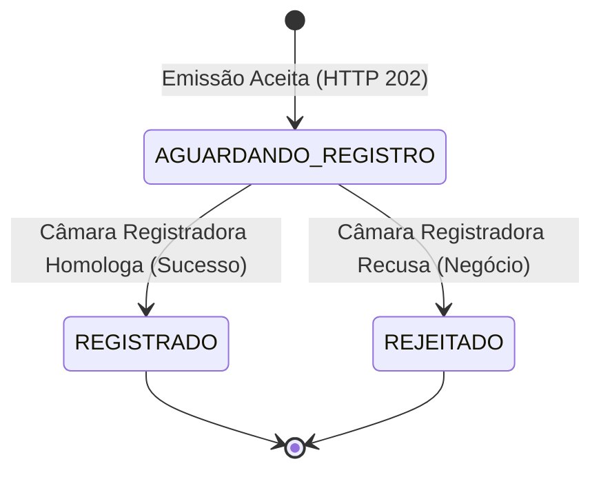

# Glossário, Regras de Domínio e Premissas de Engenharia

> Este documento consolida a linguagem ubíqua, a máquina de estados, os contratos de validação e as premissas de engenharia da Central de Cobrança e Boletos Bancários.

---

## 1. Máquina de Estados do Título

O ciclo de vida de uma cobrança na Central é modelado por uma máquina de estados estrita:

### Regras das Transições de Estado:
- **Estados Finais Imutáveis:** `REGISTRADO` e `REJEITADO` são estados definitivos. Uma vez que o título atinge um estado final, ele se torna imutável nesta esteira de processamento regulatório.
- **Isolamento entre Falha Técnica e Rejeição de Negócio:**
  - Falhas técnicas de infraestrutura (indisponibilidade da câmara, timeout de rede, oscilação de banco) **nunca alteram o estado do boleto para REJEITADO**.
  - O título permanece em `AGUARDANDO_REGISTRO` enquanto as retentativas automáticas são executadas com backoff.
  - Caso as tentativas de rede se esgotem, a mensagem é encaminhada para a Quarentena durável (DLQ) para diagnóstico de SRE, sem que um erro falso de recusa de negócio seja gravado.
- **Histórico de Transições:** Novos registros gravam atomicamente o histórico de origem (`AGUARDANDO_REGISTRO`) com a data/hora do recebimento e a transição final com a data/hora da homologação.

---

## 2. Validação Estrutural da Solicitação de Emissão

Todos os campos essenciais são validados de forma canônica na borda HTTP do `boleto-emissor` e confirmados defensivamente no consumidor do `boleto-registro` via `SolicitacaoBoletoValidator`:

| Campo | Obrigatório | Formato e Regra de Validação |
|---|:---:|---|
| `convenio` | Sim | 6 dígitos numéricos (string com zeros à esquerda preservados) |
| `numero_controle_cliente` | Sim | Texto alfanumérico de 1 a 25 caracteres (identificador no ERP do cedente) |
| `beneficiario` | Sim | Nome completo, tipo (CPF/CNPJ), documento válido e endereço completo (Logradouro, Cidade, UF com 2 letras, CEP com 8 dígitos) |
| `pagador` | Sim | Nome completo, tipo (CPF/CNPJ), documento válido e endereço completo |
| `valor_nominal` | Sim | Decimal estritamente positivo (> 0.00), com até duas casas decimais |
| `data_emissao` | Sim | Data no formato ISO-8601 (`YYYY-MM-DD`) |
| `data_vencimento` | Sim | Data igual ou posterior à `data_emissao` |
| `especie` | Sim | Código de espécie de título (ex.: `DM` — Duplicata Mercantil, `DS` — Duplicata de Serviço) |
| `juros` / `multa` | Condicional | Exige tipo (`VALOR` ou `PERCENTUAL`), valor positivo e data de início |
| `desconto` | Condicional | Exige valor positivo e data limite de aplicação |
| `abatimento` | Condicional | Exige valor positivo |

**Chave Canônica de Idempotência:** `convenio + numero_controle_cliente`.

---

## 3. Respostas HTTP e Códigos de Status Padronizados

| Situação | Código HTTP | Significado e Comportamento |
|---|:---:|---|
| **Emissão Aceita com Sucesso** | `202 Accepted` | Cobrança validada e persistida atomicamente com outbox. Retorna UUID, status `AGUARDANDO_REGISTRO` e data/hora. |
| **Erro de Validação Cadastral** | `400 Bad Request` | Lista de campos inválidos/ausentes com motivo, sem vazar dados sensíveis. |
| **Conflito de Idempotência** | `409 Conflict` | Tentativa de reenviar a mesma chave (`convenio + controle`) com dados divergentes (ex.: valor ou vencimento alterado). |
| **Identificador Malformado** | `400 Bad Request` | Identificador na URL que não atende à especificação de UUID v4 canônico. |
| **Identificador Inexistente** | `404 Not Found` | Título não localizado em nenhuma das fontes autoritativas do banco. |
| **Consulta com Sucesso** | `200 OK` | Dados consolidados do título projetados de acordo com o estado do boleto. |
| **Indisponibilidade / Falha Técnica** | `503 Unavailable` | Falha temporária em persistir com segurança ou circuito aberto na consulta; sempre acompanhado de Correlation ID. |

---

## 4. Retornos da Câmara Registradora (Simulação e Homologação)

| Retorno da Câmara | Classificação | Efeito no Domínio | Dados Pagáveis Expostos |
|---|---|---|---|
| **`OK` (Homologado)** | Sucesso Regulatório | Transita para `REGISTRADO` | Fornece `SIM-{uuid}`, `NAO-PAGAVEL-SIM-LINHA-{uuid}` e `NAO-PAGAVEL-SIM-BARRAS-{uuid}` |
| **`REJ-001` Documento Inválido** | Recusa de Negócio | Transita para `REJEITADO` | Nenhum (campos de pagamento estritamente nulos; expõe código e motivo) |
| **`REJ-002` Convênio Inativo** | Recusa de Negócio | Transita para `REJEITADO` | Nenhum |
| **`REJ-003` Vencimento Fora da Regra** | Recusa de Negócio | Transita para `REJEITADO` | Nenhum |
| **Timeout / 5xx / Queda de Rede** | Falha Técnica Transitória | Permanece `AGUARDANDO_REGISTRO` | Nenhum (aciona retentativa automática com backoff) |
| **Payload Corrompido / Quebra Contrato**| Falha Técnica Permanente | Permanece `AGUARDANDO_REGISTRO` | Nenhum (transferido para Quarentena / DLQ durável) |

---

## 5. Requisitos Não Funcionais (RNFs)

| Requisito Não Funcional | Meta / Especificação de Engenharia | Justificativa Arquitetural |
|---|---|---|
| **Pico de Ingestão** | ~500 requisições/s | Absorver lotes massivos de fechamento contábil e datas de corte dos ERPs sem timeout. |
| **Proporção Leitura : Escrita** | ~20 : 1 | A consulta em portais corporativos e polling de ERPs supera massivamente a taxa de emissão. |
| **Latência de Consulta (p95)** | < 100 ms (sub-10ms em cache) | SLA de experiência para canais de autoatendimento e impressão de 2ª via pagável. |
| **Política de Retentativas** | 3 tentativas com backoff (1s / 5s) | Recuperação automática de oscilações passageiras de rede sem sobrecarregar a câmara externa. |
| **Timeouts de Borda na Consulta** | 2 s conexão / 3 s leitura | Prevenção de exaustão de threads HTTP (*Thread Pool Exhaustion*) em caso de lentidão das fontes. |
| **Circuit Breakers** | 3 falhas consecutivas abrem por 10 s | Falha rápida (*Fast Failure*) isolada por fonte para conter falhas em cascata. |
| **TTL do Cache Caffeine** | 30 s transitório / 10 min final | Proteção de banco com expurgo imediato garantido por eventos pub/sub em tempo real. |
| **Garantia de Entrega** | At-least-once com consumidor idempotente | Não-perda de mensagens tolerando falhas de confirmação de rede pós-commit. |
| **Retenção Arquivística Fiscal** | 5 anos a partir do estado final | Conformidade com as normas regulatórias de títulos de cobrança do Sistema Financeiro Nacional. |

---

## 6. Envelopes de Eventos de Domínio (Minimização LGPD)

Tópico MULTICAST `boletos.eventos`:
- Eventos suportados: `EmissaoAceita`, `BoletoRegistrado`, `RegistroRejeitado`.
- **Envelope Canônico Mínimo (7 metadados):**
  1. `evento_id` (UUID v4 único do evento)
  2. `tipo_evento` (Nome do evento)
  3. `identificador_boleto` (UUID v4 do título)
  4. `convenio` (Código numérico de 6 dígitos)
  5. `estado_resultante` (`AGUARDANDO_REGISTRO`, `REGISTRADO`, `REJEITADO`)
  6. `data_hora_evento` (Timestamp ISO-8601 UTC)
  7. `correlation_id` (UUID v4 de rastreabilidade distribuída)
- **Privacidade e Minimização:** Nenhum nome de beneficiário, documento CPF/CNPJ, valor nominal ou dados de pagamento trafega no tópico de eventos, garantindo conformidade estrita com a LGPD e princípios de segurança da informação bancária.

---

## 7. Decisões Estratégicas de Escopo (Fase 1 MVP vs Fase 2)

Conforme formalizado na [ADR-014](../docs/adr/ADR-014-prioridade-core-e-limites-de-escopo.md):

1. **Fase 1 (MVP de Produção — Entregue):**
   - Ingestão assíncrona HTTP 202 com idempotência radical;
   - Outbox transacional e mensageria industrial com Apache ActiveMQ Artemis;
   - Consumidor resiliente com Ledger idempotente em transação independente `REQUIRES_NEW`;
   - Consulta ultrarrápida com cache-aside, fallback de consistência eventual e invalidação reativa com travas particionadas;
   - Circuit Breakers programáticos Resilience4j e rastreabilidade ponta a ponta (`X-Correlation-ID`);
   - Testes de contrato executáveis (Pact) entre Consulta e Registro.
2. **Fase 2 (Pós-Go-Live e Expansão de Negócio):**
   - Módulos de compensação e liquidação financeira interbancária (STR/CIP/PIX);
   - Esteira pós-registro de baixa comandada, prorrogação de vencimento, cancelamento e protesto cartorário;
   - Autenticação avançada mTLS com certificados digitais por convênio e políticas automatizadas de expurgo fiscal após 5 anos.
