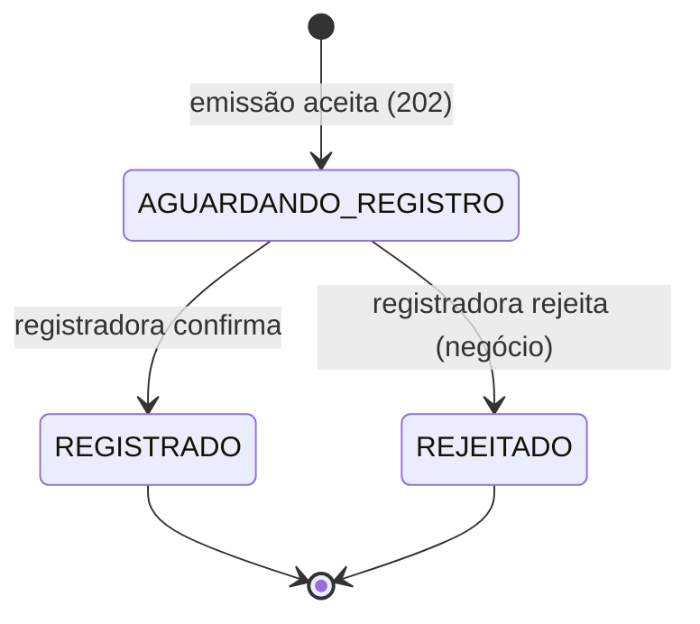

# Glossário, regras de domínio e premissas

> Consolida o que está espalhado nas sessões. Valores **[PREMISSA]** são didáticos e podem ser alterados com ADR.

## 1. Máquina de estados

- Estados finais: `REGISTRADO`, `REJEITADO` (não mudam mais; no MVP não há cancelamento/baixa).
- Falha **técnica** (registradora fora) **não muda o estado**: o boleto continua `AGUARDANDO_REGISTRO` enquanto há retentativa; esgotadas, a mensagem vai à DLQ para tratamento operacional.

## 2. Campos da solicitação de emissão

| Campo | Obrig. | Formato |
|---|:-:|---|
| convenio | Sim | 6 dígitos, string |
| numero_controle_cliente | Sim | texto, até 25 caracteres |
| beneficiario (nome, tipo_doc, documento, endereço) | Sim | CPF/CNPJ; UF 2 letras; CEP 8 dígitos |
| pagador (idem) | Sim | idem |
| valor_nominal | Sim | > 0, 2 casas |
| data_emissao | Sim | data |
| data_vencimento | Sim | ≥ data_emissao |
| especie | Sim | código (ex.: DM, DS) **[PREMISSA]** |
| juros / multa | Cond. | tipo (fixo/percentual) + valor + data inicial |
| desconto | Cond. | valor + data limite |
| abatimento | Cond. | valor |
| instrucoes / mensagem | Cond. | texto livre curto |

**Chave de idempotência:** `convenio + numero_controle_cliente`.

## 3. Respostas HTTP

| Situação | Código |
|---|:-:|
| Emissão aceita | 202 |
| Campo inválido/ausente | 400 (lista de campos) |
| Mesma chave, conteúdo diferente | 409 |
| Aceite impossível com segurança | 503 |
| Consulta encontrada (qualquer estado) | 200 |
| Identificador inexistente | 404 |
| Identificador mal formado | 400 |
| Falha técnica na consulta | 503 + correlation_id |

## 4. Retornos simulados da registradora (hipótese didática)

| Retorno | Tipo | Efeito |
|---|---|---|
| `OK` (traz linha digitável, código de barras, id definitivo) | sucesso | `REGISTRADO` |
| `REJ-001` documento do pagador inválido | negócio | `REJEITADO` |
| `REJ-002` convênio inativo | negócio | `REJEITADO` |
| `REJ-003` vencimento inválido | negócio | `REJEITADO` |
| timeout / 5xx / indisponível | técnica temporária | retry |
| mensagem malformada | técnica permanente | DLQ |

> **[PREMISSA]** Códigos inventados para o exercício; o contrato real deve ser validado (Caio).

## 5. Requisitos não funcionais **[PREMISSA]**

| RNF | Valor |
|---|---|
| Pico de emissão | ~500/s |
| Proporção leitura:escrita | ~20:1 |
| Latência de consulta (p95, com cache) | < 100 ms |
| Retry | 3 tentativas, backoff 1/2/4 s |
| Timeout da registradora | 5 s |
| TTL do cache | 30 s transitório; 10 min final |
| Entrega | at-least-once + consumidor idempotente |
| Retenção | 5 anos após encerramento |

## 6. Eventos de domínio (payload mínimo)

`EmissaoAceita`, `BoletoRegistrado`, `RegistroRejeitado` → `id_evento`, `tipo`, `identificador_boleto`, `convenio`, `status`, `data_hora`, `correlation_id`. **Sem dados pessoais.**

## 7. Auditoria e privacidade

- Campos de auditoria: `ator`, `ação`, `identificador_boleto`, `data_hora`, `resultado`, `correlation_id`.
- Logs: sem boleto completo; documento mascarado; sem valor/endereço.
- DLQ: acesso restrito, reprocessamento auditado.

## 8. Glossário consolidado

Emissão · Registro · Título · Boleto recém-emitido · Aceite assíncrono · Chave de idempotência · Conflito (409) · Aguardando registro · Cache-aside · Cache miss · Estado transitório · Estado final · DLQ · Outbox · Evento de domínio · Idempotência do consumidor · Trilha de auditoria · Minimização · Correlação · Retenção (definições nas sessões 1–5).

## 9. Pontos em aberto → viram ADR (decisão do time de dev)

1. **Onde fica o estado inicial** (AGUARDANDO_REGISTRO) para a consulta enxergar logo após o aceite? (Sessão 3)
2. Como o cache da consulta é invalidado quando outro serviço muda o estado (TTL curto × evento)?
3. Outbox e eventos entram no MVP do grupo ou ficam como opcional?
4. Mecanismo de broker em Plano B (Qpid embarcado) ou C (in-process).

## 10. Premissas a validar (do documento original)

Contrato e códigos da registradora · campos por produto e convênio · política de retentativas e timeouts · metas de latência, disponibilidade e capacidade · prazo de retenção e marco inicial · conteúdo e classificação dos eventos.
