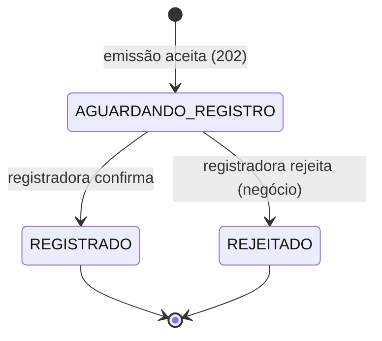

# Glossário, regras de domínio e premissas

> Consolida o que está espalhado nas sessões. Valores **[PREMISSA]** são didáticos e podem ser alterados com ADR.

## 1. Máquina de estados

- Estados finais: `REGISTRADO`, `REJEITADO` (não mudam mais; no MVP não há cancelamento/baixa).
- Falha **técnica** (registradora fora) **não muda o estado**: o boleto continua `AGUARDANDO_REGISTRO` enquanto há retentativa; esgotadas, a mensagem vai à DLQ para tratamento operacional.

> Na E8 há **isolamento do produtor na outbox H2** e **quarentena durável no Artemis** para falhas do consumidor. O boleto permanece `AGUARDANDO_REGISTRO` se não houve resultado de negócio, inclusive após esgotar tentativas; isso não autoriza inventar rejeição. A E7 guarda o histórico dos novos resultados junto com a transição final; o aceite original fica no emissor. Recuperação autorizada/auditada ainda E11/E12. Ver [E8](../docs/etapas/E8-broker-jvm.md).

## 2. Campos da solicitação de emissão

| Campo | Obrig. | Formato |
|---|:-:|---|
| convenio | Sim | 6 dígitos, string |
| numero_controle_cliente | Sim | texto, até 25 caracteres |
| beneficiario (nome, tipo_doc, documento, endereço) | Sim | CPF/CNPJ; UF 2 letras; CEP 8 dígitos |
| pagador (idem) | Sim | idem |
| valor_nominal | Sim | > 0, 2 casas |
| data_emissao | Sim | data |
| data_vencimento | Sim | ≥ data_emissao |
| especie | Sim | código (ex.: DM, DS) **[PREMISSA]** |
| juros / multa | Cond. | tipo (fixo/percentual) + valor + data inicial |
| desconto | Cond. | valor + data limite |
| abatimento | Cond. | valor |
| instrucoes / mensagem | Cond. | texto livre curto |

**Chave de idempotência:** `convenio + numero_controle_cliente`.

Matriz exata de formatos, limites implementados e premissas não transformadas em regras: [E7](../docs/etapas/E7-contrato-funcional.md). O validador estrutural é reutilizado na emissão e no comando de registro; não há consulta ao banco de outro serviço.

## 3. Respostas HTTP

| Situação | Código |
|---|:-:|
| Emissão aceita | 202 |
| Campo inválido/ausente | 400 (lista de campos) |
| Mesma chave, conteúdo diferente | 409 |
| Aceite impossível com segurança | 503 |
| Consulta encontrada (qualquer estado) | 200 |
| Identificador inexistente | 404 |
| Identificador mal formado | 400 |
| Falha técnica na consulta | 503 + correlation_id |

Com outbox, na E9 `202` exige commit local de aceite + comando + intenção de evento, não disponibilidade imediata do transporte. `503` corresponde à impossibilidade de persistir com segurança; indisponibilidade após o commit será tratada pelos despachantes.

## 4. Retornos simulados da registradora (hipótese didática)

| Retorno | Tipo | Efeito |
|---|---|---|
| `OK` (traz linha digitável, código de barras, id definitivo) | sucesso | `REGISTRADO` |
| `REJ-001` documento do pagador inválido | negócio | `REJEITADO` |
| `REJ-002` convênio inativo | negócio | `REJEITADO` |
| `REJ-003` vencimento inválido | negócio | `REJEITADO` |
| timeout / 5xx / indisponível | técnica temporária | retry |
| mensagem malformada | técnica permanente | DLQ |

> **[PREMISSA]** Códigos inventados para o exercício; o contrato real deve ser validado (Caio).

**Implementação atual (E7):** cenários `APROVAR`, `REJEITAR` e `INDISPONIVEL`. Novas aprovações fornecem `SIM-{uuid}`, instante e marcadores `NAO-PAGAVEL-SIM-LINHA-{uuid}` / `NAO-PAGAVEL-SIM-BARRAS-{uuid}`. Não são dados bancários válidos. Rejeição usa `SIM-REJ-001`, sem campos de pagamento/registro. A tabela acima continua sendo hipótese do contrato real.

O resultado simulado é persistido por UUID em transação independente: mesmo comando recupera a resposta, inclusive após perda de resposta/rollback local; conteúdo diferente conflita. Novos resultados locais têm histórico atômico de origem e estado final. Finais antigos não são reprocessados nem recebem fatos retroativos inventados. Ver [ADR-010](../docs/adr/ADR-010-contrato-funcional-e-idempotencia-registradora.md).

## 5. Requisitos não funcionais **[PREMISSA]**

| RNF | Valor |
|---|---|
| Pico de emissão | ~500/s |
| Proporção leitura:escrita | ~20:1 |
| Latência de consulta (p95, com cache) | < 100 ms |
| Retry | E8: 3 tentativas de publicação na outbox e 3 entregas de processamento no broker, fronteiras separadas; mínimos 1 s/5 s ([ADR-011](../docs/adr/ADR-011-broker-jvm-artemis.md), preserva decisão E5 e substitui premissa 1/2/4 s) |
| Timeout da registradora | 5 s |
| TTL do cache | 30 s transitório; 10 min final |
| Entrega | at-least-once + consumidor idempotente |
| Retenção | 5 anos após encerramento |

Capacidade e p95 ainda não foram medidos; a proporção de tráfego e a retenção permanecem hipóteses. TTL é a política provisória da E3, complementada por invalidação final na E9; expiração/carga integradas ainda E14. As transcrições originais são preservadas.

## 6. Eventos de domínio (payload mínimo)

`EmissaoAceita`, `BoletoRegistrado`, `RegistroRejeitado` → `id_evento`, `tipo`, `identificador_boleto`, `convenio`, `status`, `data_hora`, `correlation_id`. **Sem dados pessoais.**

E9: intenção junto ao estado em cada banco produtor; publicação JMS persistente/transacional independente; assinaturas duráveis no mesmo broker Artemis. Confirmação perdida pode repetir o mesmo id de evento; consulta invalida idempotentemente, sem projetar dados nem rebaixar por ordem. E10 propaga UUID v4 validado/gerado no HTTP ao comando/outbox/JMS, evento e consulta; legado sem campo usa UUID do boleto. Correlação não é chave de idempotência e reenvio não reescreve a intenção original. Uma instância de consulta por demonstração; múltiplas instâncias com cache local exigiriam assinaturas exclusivas. [ADR-012](../docs/adr/ADR-012-eventos-e-invalidacao.md) / [ADR-013](../docs/adr/ADR-013-resiliencia-e-correlacao.md).

## 7. Auditoria e privacidade

- Campos de auditoria: `ator`, `ação`, `identificador_boleto`, `data_hora`, `resultado`, `correlation_id`.
- Logs: sem boleto completo; documento mascarado; sem valor/endereço.
- DLQ: acesso restrito, reprocessamento auditado.

## 8. Glossário consolidado

Emissão · Registro · Título · Boleto recém-emitido · Aceite assíncrono · Chave de idempotência · Conflito (409) · Aguardando registro · Cache-aside · Cache miss · Estado transitório · Estado final · DLQ · Outbox · Evento de domínio · Idempotência do consumidor · Trilha de auditoria · Minimização · Correlação · Retenção (definições nas sessões 1–5).

## 9. Decisões tomadas e pendências do grupo

1. **Estado inicial:** aceite persistido no emissor. A consulta tenta o registro e, somente após 404, busca o aceite no emissor — opção C aceita na [ADR-004](../docs/adr/ADR-004-fonte-do-estado-inicial.md). Essa opção C de consulta não é o perfil C de execução.
2. **Cache:** Caffeine com TTL de 30 s transitório/10 min final, conforme [ADR-006](../docs/adr/ADR-006-cache-consulta.md), complementada pela [ADR-012](../docs/adr/ADR-012-eventos-e-invalidacao.md): evento final invalida de forma coordenada com preenchimento em voo.
3. **Outbox:** comando transacional na [ADR-005](../docs/adr/ADR-005-saga-e-outbox-no-mvp.md); E9 acrescenta intenção de evento junto ao aceite/resultado em cada produtor, sem compartilhar bancos.
4. **Transporte:** E8/E9 usam **Artemis 2.33.0/Jakarta JMS em JVM própria**, journal NIO, comando ANYCAST, eventos MULTICAST com assinaturas duráveis e quarentenas. Sem Docker nem fallback HTTP. [ADR-011](../docs/adr/ADR-011-broker-jvm-artemis.md) substitui o transporte provisório da [ADR-007](../docs/adr/ADR-007-transporte-assincrono.md); [ADR-012](../docs/adr/ADR-012-eventos-e-invalidacao.md) adiciona eventos.
5. **Retry/quarentena:** orçamentos separados por fronteira, mínimos 1 s/5 s, ack JMS após commit JPA e erros permanentes transferidos atomicamente. Pendentes antigos preservam UUID/contadores; isolados não são reiniciados. Replay restrito/auditado ainda E11/E12.
6. **Grupo/escopo:** três integrantes confirmados, nenhum opcional adicional obrigatório; E13 não aplicável. Em 20/10/2026, após orientação docente de seguir apenas os critérios de avaliação informada pelo usuário, o [roteiro F1–F3](../ROTEIRO.md) substitui os portões E11–E15, preservando E0–E10. Referências anteriores a E11/E12/carga são históricas, não pendências. Acesso/auditoria/criptografia/retenção da Sessão 5 e replay restrito continuam não implementados, fora da entrega avaliada; não alegar conformidade ou desempenho não medido. Especificação original preservada; [ADR-014](../docs/adr/ADR-014-prioridade-core-e-limites-de-escopo.md). Nomes/papéis continuam pendentes.
7. **Resiliência/correlação E10:** fontes HTTP da consulta com conexão 2 s/leitura 3 s e circuitos independentes (três falhas nas últimas três chamadas, OPEN 10 s, uma sonda); 404/rejeição 200 não são indisponibilidade. Sem retry HTTP extra; limite de socket não é SLA global. Header de correlação opcional, UUID v4 canônico; inválido -> 400 antes do domínio. Auditoria completa continua E11. [E10](../docs/etapas/E10-resiliencia-e-correlacao.md).

## 10. Premissas a validar (do documento original)

Contrato e códigos da registradora · campos por produto e convênio · política de retentativas e timeouts · metas de latência, disponibilidade e capacidade · prazo de retenção e marco inicial · conteúdo e classificação dos eventos.
